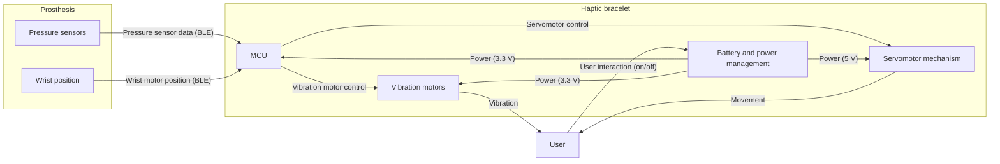
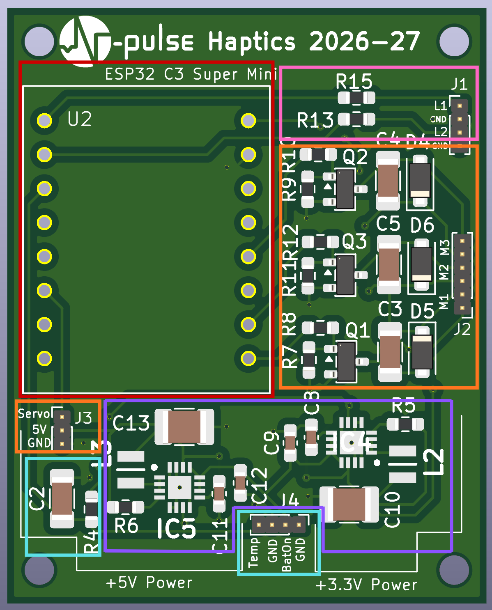
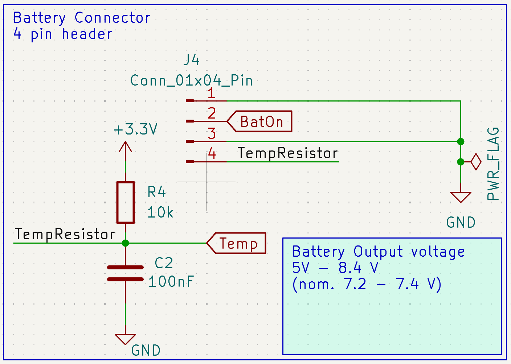
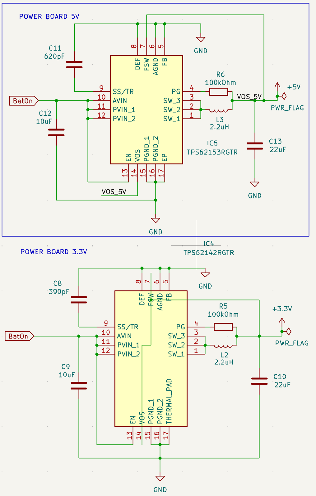
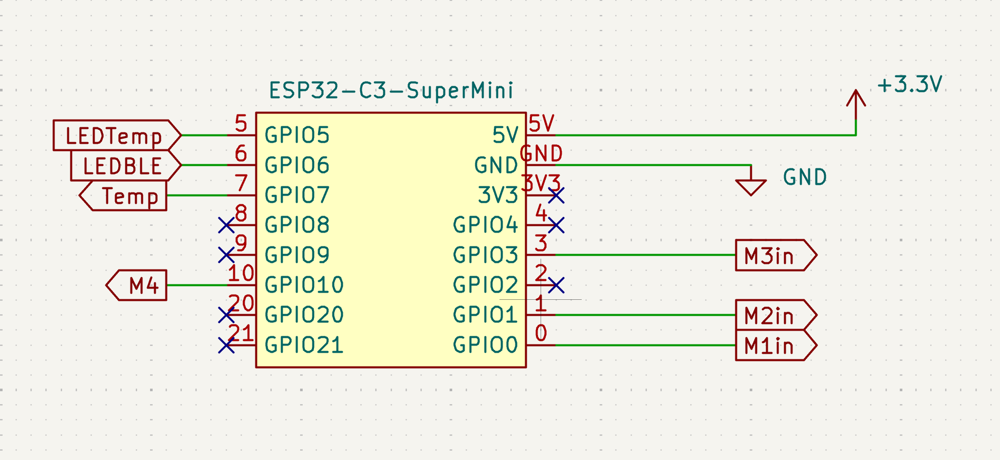
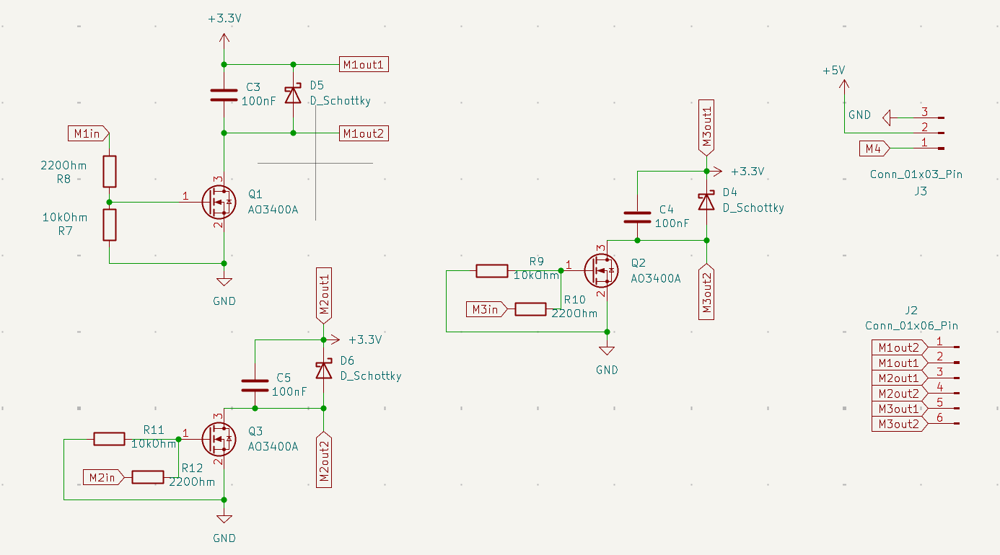
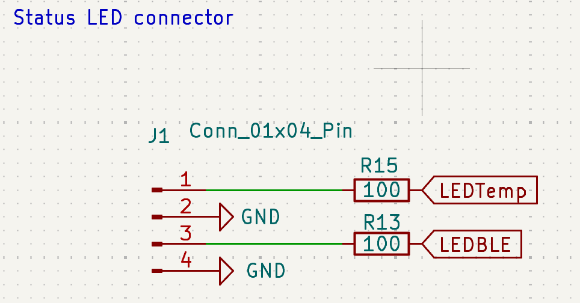
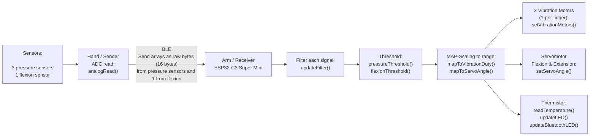

# Design Solution Definition: `Haptics`

> **Project:** `Haptics`
> **Document ID:** `DSD-01-Haptics`
> **Version:** `0.1.0` · **Status:** `Draft`
> **Project phase:** `Proof of concept`
> **Last modified:** `2026-10-17`
> **Repository path:** `Haptics-2026/SDR/DSD_Haptics-01.md`

---

## Document control

### Roles and sign-off

| Role | Name | Affiliation / Handle | Date | Signature / Review link |
|---|---|---|---|---|
| Author(s) | Ana Benavente | Team Leader / anabenaventez-hub | | |
| Reviewer (technical) | | | | |
| Concurrence (SE Reviewer) | | | | |
| Concurrence (Quality management reviewer) | | | | |
| Approval (Project Manager) | | | | |

> Note : Link approval to any relevant PR (Pull Request)
> Affiliation/Handle : Role/ Username on Github

### Modification log

| Version | Date | Author(s) | Main changes | PR / Commit |
|---|---|---|---|---|
| 0.1.0 | 2026-10-17 | Ana Benavente | First version | |
| 0.1.0 | 2026-10-25 | Jean Castelier | Updated mechanics | |
| 0.1.0 | 2026-10-25 | Giuliana Dellios | Updated firmware | |
| 0.1.0 | 2026-10-25 | Camilla Varotto | Updated electronics | |

---

## Table of contents

1. [Introduction](#1-introduction)
2. [Requirements and traceability](#2-requirements-and-traceability)
3. [Concept justification](#3-concept-justification)
4. [Traded-off concepts](#4-traded-off-concepts)
5. [Quality management and compliance](#5-quality-management-and-compliance) /!\ THIS SECTION IS NOT FINALISED /!\
6. [Licensing](#6-open-source-considerations) /!\ THIS SECTION IS NOT FINALISED /!\
7. [Open issues and future work](#7-open-issues-and-future-work)
8. [References](#8-references)
9. [Appendices](#9-appendices)

---

## 1. Introduction

### 1.1 Purpose and scope

This Design Solution Definition (DSD) is at a `Proof of concept` stage
validated on `<date>`. It justifies the concept selected for `Haptics`.

It covers:

- the problem the subsystem must solve
- the retained concept: architecture, components, and design choices
- the concepts that were considered and not retained
- risks, quality, and compliance implications.

**Out of scope:** `Not relevant.`

### 1.2 Responsibility and change authority

- **Document owner:** `Ana Benavente / Haptics` <!-- Who is responsible to keep this document up to date ? --> 
- **Change authority:** `Team Leader / N-Pulse` <!-- What is the role/responsibility of the person -->

### 1.3 Abbreviated terms and definitions

| Term | Definition |
|---|---|
| `BLE` | `Bluetooth Low Energy` |
| `ERM` | `Eccentric Rotator Mass` |
| `GND` | `Ground` |
| `IC`  | `Integrated Circuit` |
| `LED` | `Light-Emitting Diode` |
| `LRA` | `Linear Resonant Actuator` |
| `MCU` | `Microcontroller Unit` |
| `NTC` | `Negative Temperature Coefficient` |
| `PCB` | `Printed Circuit Board` |
| `PWM` | `Pulse Width Modulation` |

## 2. Requirements and traceability

| Requirement ID | Verification method | Status |
|---|---|---|
| HA-001  | D  | In-progress  |
| HA-002  | I  | In-progress |
| HA-003  | T  | To do  |
| HA-004  | D  | In-progress   |
| HA-005  | T  |  In-progress  |
| HA-006  | T  | In-progress |
| HA-007  | D  | In-progress   |
| HA-008  | T  | To-do  |
| HA-009  | I  | In-progress   |
| HA-010  | T  | In-progress   |
| HA-011  | T  | To do  |
| HA-012  | T | In-progress |
| HA-013  | T | In-progress |
| SYS-041  | D  | To do |
| SYS-040  | D  | To do  |
| SYS-039  | D  | To do  |
| SYS-034 | D  | In-progress  |
| SYS-035  |  M | To do  |
| SYS-031  | T  | To do  |
| SYS-029  | T  | In-progress  |
| SYS-030 | D |  In-progress |
| SYS-028  | T  | In-progress  |
| SYS-027  | T  | To do  |
| SYS-021  | D  | To do  |
| SYS-022 | I  | To do  |
| SYS-019  |  T | In-progress  |
| SYS-020  | T  | In-progress  |
| SYS-018  | T  | To do |
| SYS-016 | T  | To do  |
| SYS-011  | D  | In-progress  |
| SYS-010  | T  | To do  |
| SYS-017  | T  | To do  |
| SAF-005 | I  | In-progress  |
| SAF-008  | T  | In-progress  |
| SAF-009 | T  | To do  |

> **Verification methods:** (D)emonstration, (T)est, (M)easurement, (I)nspection, (A)nalysis
 

---

## 3. Concept justification

### 3.1 Solution overview

`The retained concept is a wearable bracelet that turns the contact pressure measured at the prosthesis finger tips into vibration on the user’s skin, addressing the problem of sensation feedback. Pressure readings are sent wirelessly to the bracelet, where an MCU converts them into vibration feedback of different intensities, so the user can feel the exerted force without having to look at the hand. Additionally, the prosthesis’s wrist extension and flexion, given by the motor position, are also sent to the bracelet, which reproduces this movement with a servomotor linear mechanism. The architecture was selected to meet all the requirements while keeping power consumption low, the device compact, and operation safe, comfortable and reliable for the user.`

*Figure 3.1: High-level architecture of `Haptics`.*

### 3.2 Main design choices

#### 3.2.1 `Battery and power system`

- **Decision:** `Power the bracelet using a 7.4 V 3400 mA 2S Li-Ion pack through an on/off switch with 2 buck converters (3.3 and 5 V) as well as temperature control via the NTC thermistor.`
- **Rationale:** `Prioritize battery and user safety, as well as efficient buck conversion for stable rails and have enough headroom for the 5V rail, for a battery life of minimum 4 hours.`
- **Requirements addressed:** `HA-001, HA-011, SYS-034, SYS-019, SYS-020, SYS-018, SYS-010, SAF-008.`
- **Consequences / limitations:** `Need of 2S protection board and charger, and visible warning of temperature as well as thermometer calibration.`

#### 3.2.2 `Wireless communication`

- **Decision:** `Use an ESP32-C3 Super Mini as the bracelet's MCU, receiving pressure and wrist-position data from the prosthesis via BLE.`
- **Rationale:** `BLE is built onto the chip and is low power, removing any wires between the prosthesis and bracelet, allowing the user to manipulate the bracelet separately.`
- **Requirements addressed:** `HA-009, SYS-029, SYS-016, SYS-017.`
- **Consequences / limitations:** `Latency and range depend on BLE.`

#### 3.2.3 `Pressure sensors and circuit`

- **Decision:** `Use 5 (one per fingertip) resistive force-sensing sensors (FSR 400) to transduce contact pressure into an analog signal, each read through a voltage divider with a fixed resistor (1 kΩ), chosen experimentally to maximize sensitivity over the force range in which haptic feedback is needed.`
- **Rationale:** `Thin, low-cost, responsive to light contact, and low-power.`
- **Requirements addressed:** `HA-004, HA-005, HA-006, HA-007, HA-008, HA-009, HA-010, SYS-028, SYS-021, SYS-011.`
- **Consequences / limitations:** `Need of calibration, has a non-linear response, and a sensitivity trade-off fixed by the resistor for force ranges.`

#### 3.2.4 `Vibration feedback`

- **Decision:** `Render the pressure measured at 3 of the prosthesis finger tips sensors as vibration on the skin, using 3 vibration motors with intensity increasing along with sensed pressure.`
- **Rationale:** `Direct way of reproducing sensation by stimulating tactile receptors intuitively and perceptively, using 3V vibration motors which are low-cost, low-power, and light. By only having 3 out of the 5 signals as outputs, the user gets enough pressure information without having to being overstimulated.`
- **Requirements addressed:** `HA-002, HA-003, HA-004, HA-005, HA-006, HA-007, HA-008, SYS-031, SYS-028, SYS-021, SYS-011.`
- **Consequences / limitations:** `Skin could adapt to continuous vibration, so sustained contact could become less noticeable over time, and intensity levels have a resolution trade-off, limited by latency.`

#### 3.2.5 `Servomotor feedback`

- **Decision:** `Render the prosthesis's wrist position (flexion/extension), given by the wrist motor position, as a movement of a servomotor mechanism on the bracelet.`
- **Rationale:** `Motion following the natural direction and position of the wrist intuitively.`
- **Requirements addressed:** `HA-002, HA-003, SYS-031.`
- **Consequences / limitations:** `Adds to power draw, size and mechanical & electrical complexity, must be comfortable and safe, and range must be matched to wrist movement, also limited by latency.`

#### 3.2.6 Operating modes

| Mode / Stage | Purpose | Entry condition | Exit condition | Active components |
|---|---|---|---|---|
| Idle | Wait for the prosthesis to connect with minimal power use and no output to the user.|Power switch turned on and boot finished (after Calibration), or BLE link lost while no fault is present.  | BLE connection established with the prosthesis (goes to Nominal) or a fault is detected (goes to Safe / fault).| MCU with BLE advertising, power management (buck converters), BLE status LED. Vibration motors, servomotor and drivers are off.|
| Nominal operation |Convert incoming pressure and wrist position data into vibration and servomotor feedback. |BLE connected and valid data being received.|BLE link lost or no data (goes to Idle), fault detected (goes to Safe / fault), or power switch off. | MCU and BLE, vibration motors with their drivers (PWM), servomotor, battery and power rails, temperature monitoring (NTC). |
| Calibration | Move the servomotor to position 0 so it always starts from the same reference, matching the zero of the prosthesis’s wrist position.| Power switch turned on (runs automatically after boot), or re-homing requested by the user or over BLE.| Servomotor reaches position 0 (goes to Idle), or homing fails (goes to Safe / fault).|MCU, servomotor and its 5 V rail. Vibration motors off, BLE can start in parallel. |
| Safe / fault state | Protect the user and the hardware by stopping the outputs when battery's temperature rises or the switch is turned off.|Battery temperature above 40 °C or turned off manually. | Condition cleared (goes to Idle), or a latched fault requires the user to switch off and on. | MCU, temperature monitoring (NTC), over-temperature LED. Vibration motors and servomotor are disabled. BLE can stay on to report the fault.|

### 3.3 Functionally linked systems

#### 3.3.1 `Electronics circuits`

This section describes the electronic circuit design of the latest PCB iteration. The PCB integrates the power supply, MCU, motor drivers, temperature monitoring, and status LED interfaces into a single 2-layer board (36x45 mm) with 4 M1 mounting holes.

  

  <em>Figure 1: PCB layout of the latest system iteration, highlighting the main functional blocks. In light blue: the battery connection and temperature monitoring circuit; in purple: the power supply circuits; in red: the MCU; in orange: the motor drivers and motor connections; in pink: the LEDs interface.  </em>

###### 3.3.1.1 `Battery Connection and Temperature Monitoring`

The battery interface provides the electrical connection between the battery and the PCB, enables manual system power via a rocker switch, and supports battery temperature monitoring to improve system safety.

  

  <em>Figure 2: Schematic of the battery connector and temperature monitoring circuit.</em>

The battery interface consists of a four-pin header connector `J4`, connected to the temperature monitoring circuit (`TempResistor`). The functions of the four connector pins are described below:
- **Pin 1 - Switch ground**: Connected to the external switch (E-Switch, RA12131121) and provides the ground connection required for its operation when the system is manually switched off.
- **Pin 2 – Battery supply (`BatOn`)**: Receives the battery supply voltage when the external switch is manually activated by the user.
- **Pin 3 – Ground**: Connected to the battery ground, providing a common ground reference for the PCB and external components.
- **Pin 4 – Temperature sensing**: Connected to the battery's temperature-dependent resistive wire, whose resistance decreases as the battery temperature increases (NTC).

The temperature monitoring circuit uses a voltage divider to convert the temperature-dependent resistance into a voltage at the node labelled `Temp`. This voltage is read by the MCU, which uses it to determine whether the battery temperature has exceeded the defined safety threshold and whether the system should be switched off.

The 10 kΩ resistor `R4` is used as part of the voltage divider to establish the relationship between the temperature-dependent resistance and the voltage measured at the `Temp` node. Its selection is based on the nominal resistance range of the temperature-dependent resistive wire and the desired measurement sensitivity. 
The 100 nF capacitor `C2` is connected to node `Temp` and is intended to filter voltage fluctuations and stabilize the temperature measurement. Its capacitance was selected based on standard heuristics, a 100nF is a baseline local bypass value.

The external switch (E-Switch, RA12131121) is a rocker switch, that was selected to provide ease of use for the user, simplfied mechanical integration (snap-in mounting) within the bracelet, and suitable current and voltage ratings for the external battery. 

The `Temp` signal is connected to MCU pin `GPIO7`, which monitors the voltage and triggers a system shutdown when the defined temperature threshold is reached. The corresponding threshold will be set experimentally to be associated with a battery temperature of 40°C.

The manual power switch and temperature monitoring circuit therefore provide user-controlled power management and temperature-based system protection.

##### 3.3.1.2 `Power Supply: 5 V and 3.3 V Rails`

The power supply consists of two DC–DC buck converters that convert the battery voltage into regulated 5 V and 3.3 V supply rails. The 5 V rail powers the servomotor, while the 3.3 V rail supplies the MCU and the three vibration motor drivers.

  

  <em>Figure 3: Schematic of the two power supply circuits.</em>

The 5 V rail is generated by the Texas Instruments TPS62153 integrated circuit (`IC5`), while the 3.3 V rail is generated by the TPS62142 (`IC4`). Both are buck converters, which reduce the battery voltage to a lower, regulated output voltage.
Each converter uses an inductor, input and output capacitors, a soft-start capacitor, and a resistor connected to the `PG` pin. The inductors `L3` and `L2` (2.2 µH) are part of the switching circuits that transfer energy from the input to the output. The input capacitors `C12` and `C9` (10 µF) help stabilize the voltage supplied to the converters from `BatOn`, while the output capacitors `C13` and `C10` (22 µF) smooth the output voltage and help handle sudden changes in load current.
The capacitors connected to the `SS/TR` pins control the soft-start behaviour of the converters. Soft-start allows the output voltage to rise gradually when the circuit is switched on, reducing the initial current demand. `C11` (620 pF) is used in the 5 V circuit, while `C8` (390 pF) is used in the 3.3 V circuit. Resistors `R6` and `R5` (100 kΩ) connect the `PG` pins to their respective output rails. These resistors act as pull-up for the converters' power-good signals, which indicate whether the output voltage has reached an acceptable level.

The converter ICs and their external components were selected using Texas Instruments' WEBENCH® Power Designer, a tool for designing switching power supplies and selecting suitable components. The design was based on the required output voltages, the battery's input voltage range, and the expected load currents.

The PCB layout was designed with reference to the manufacturer's layout recommendations. The placement of components and routing of tracks are important in switching power supplies because they affect electrical noise, unwanted voltage variations, and power losses.

The input capacitors were placed close to the converter ICs to reduce the length of the paths carrying rapidly changing currents. The inductors were placed close to the switching nodes, and high-current tracks were kept short to reduce resistance and unwanted electrical effects. The output voltage-sensing connections were routed close to the output capacitors and away from the switching nodes to reduce interference with these sensitive signals. The analog ground (`AGND`), power ground (`PGND`), and exposed thermal pad were connected to the common ground. 

The battery connector `J4` was positioned near the power supply circuits. The two converters share the battery input (`BatOn`) and the ground reference, while providing separate regulated outputs for the system's components.

##### 3.3.1.3 `Microcontroller`

The MCU used in the system is the ESP32-C3 Super Mini, which coordinates the operation of the servomotor and the three vibration motors based on pressure data received from the prosthesis main board. It communicates with the main board via BLE and generates PWM signals to control motor actuation. The microcontroller also controls two status LEDs, which indicate the temperature-monitoring and BLE communication status.

  

  <em>Figure 4: Schematic of MCU.</em>

The servomotor control signal `M4` is connected to `GPIO10` pin. The three vibration motor drivers `M1`, `M2` and `M3` are controlled through `GPIO0`, `GPIO1`, and `GPIO3` pins, respectively. PWM signals allow the motor actuation to be adjusted by varying the duty cycle. The vibration motors are connected through transistor-based driver circuits (see Section 3.3.1.4), since the MCU GPIOs cannot directly supply the current required by the motors.

The MCU also controls two status LEDs: the temperature-monitoring LED (`LEDTemp`) through `GPIO5` and the BLE status LED (`LEDBLE`) through `GPIO6` to  provide visual indications of the system's operating status (see Section [3.3.2](#332-firmware)).

The pressure data received via BLE from the prosthesis main board are processed by the firmware (see Section [3.3.2](#332-firmware)), which determines the corresponding motor commands. These commands are then translated into PWM signals to control the servomotor and vibration motor drivers.

The ESP32-C3 is powered by the regulated 3.3 V rail and connected to the common ground. `GPIO8`, `GPIO9`, `GPIO20`, `GPIO4`, and `GPIO2` are left unconnected in the current design because they are not required for the implemented functionality. 

The ESP32-C3 Super Mini is mounted on the PCB using through-hole pin headers.

##### 3.3.1.4 `Transistor-Based Motor Drivers and Motor Connectors`  

The three vibration motors (`M1`, `M2`, and `M3`) are controlled by transistor-based driver circuits, which allow the MCU to regulate motor activation without supplying the motor current directly through its GPIO pins. Each driver uses an N-channel MOSFET configured as a low-side switch, controlled by a PWM signal generated by the MCU.

A 6-pin header connector interfaces the three vibration motors with the driver circuits. Each motor is connected between two terminals: `M_out1`, connected to the regulated 3.3 V rail, and `M_out2`, connected to the MOSFET drain. 
A separate 3-pin header connects the servomotor to the PCB. Its pins provide the PWM control signal (`M4`), ground, and the regulated 5 V supply, respectively.

  

  <em>Figure 5: Schematic of the three vibration motor drivers and the connectors for the vibration motors and servomotor.</em>

The switching components (`Q1`, `Q2`, and `Q3`) are AO3400A N-channel MOSFETs. Their sources are connected to ground, while their drains are connected to the respective motor terminals (`M1out2`, `M2out2`, and `M3out2`). The other motor terminals (`M1out1`, `M2out1`, and `M3out1`) are connected to the regulated 3.3 V rail. When a MOSFET is switched on, current flows from the 3.3 V supply through the corresponding motor and MOSFET to ground, activating the motor. When the MOSFET is switched off, the supply current is interrupted. By driving the MOSFETs with PWM signals, the MCU adjusts the effective power delivered to each motor by varying the duty cycle.

The MOSFET gates are controlled by the MCU signals `M1in`, `M2in`, and `M3in` through the 220 Ω series resistors `R8`, `R12`, and `R10`, respectively. These resistors limit the transient current required to charge and discharge the MOSFET gate capacitances during switching. The 10 kΩ pull-down resistors (`R7`, `R11`, and `R9`) connect the gates to ground, ensuring that the MOSFETs remain off when the corresponding control signals are low or not actively driven.

The AO3400A was selected as a compact N-channel MOSFET suitable for low-side switching. Its low on-state resistance at a gate-source voltage of 2.5 V supports operation with the ESP32-C3's 3.3 V control signals. The selection must also account for the motors' operating and startup currents to ensure that the MOSFETs remain within their electrical and thermal limits.

Each motor driver also includes a 100 nF capacitor (`C3`, `C5`, or `C4`) connected across the motor terminals to help suppress high-frequency electrical noise. Schottky diodes (`D5`, `D6`, and `D4`) are connected in parallel with the motors to provide a path for the inductive current when the MOSFETs switch off. This helps limit voltage spikes and protects the switching transistors.

The three vibration motors can therefore be controlled independently through their respective driver circuits and MCU GPIOs. The servomotor is connected separately through its 3-pin header, which provides its control signal, power supply, and ground connections.

##### 3.3.1.5 `Status LED Interface`  

The system comprises two status LEDs: a yellow LED for temperature monitoring and a blue LED for BLE connection status. Both LEDs are connected to the PCB through a 4-pin header and are controlled by the MCU via the `LEDTemp` and `LEDBLE` signals, connected to `GPIO5` and `GPIO6`, respectively.

  

  <em>Figure 6: Schematic of the LED connector.</em>

The selected LEDs are the C566E-AFF-CV0X0252 (yellow) and C566E-BFF-CU14Q3S2 (blue), manufactured by Cree LED. Each LED is connected to the MCU through a 100 Ω series resistor (`R15` and `R13`, respectively), which limits the current flowing through the LED. The resistor values were selected based on the LEDs' operating current requirements.

#### 3.3.2 `Firmware`
##### System Flowchart

##### General code architecture
The firmware is split into two independent Arduino sketches, one running on each board, with each sketch itself broken into multiple tabs.

On the hand side, the sender sketch (BLE_sender.ino) runs a loop that, every cycle, reads the three sensors (pressure sensors) through analogRead(). These three values are packed into a small array and are then converted into bytes (16 bytes). The array is sent out over Bluetooth Low Energy in pack every 5-10 ms (TBD). 
Each packet will include a header containing a packet number (to detect and count dropped packets) followed by the sensor data, with the header specifying how many bytes are allocated to the pressure values and how many to the wrist/flexion position value. This allows the receiver to detect when a packet goes missing, not just whether the connection currently exists. In addition to the pressure and flexion values already sent, the sender will also transmit motor/servo position data, which the receiver will use to directly control the servo’s position, rather than deriving it only from the flexion sensor as currently implemented.

On the arm side, the receiver sketch (BLE_receiver.ino) acts as the BLE client: it connects to the sender, awaits for incoming data, and unpacks it back into values. Each value is applied updateFilter() to smooth out raw readings. Then each filtered value passes through pressureThreshold() or flexionThreshold() to clamp it into a known, safe range. Each pressure value is sent to its corresponding vibration motor, and the flexion value is converted into an angle for the servomotor, using the mapping functions in (mapping.ino). Separately from this Bluetooth data flow, the receiver also reads a thermistor connected directly to the board, calculates the actual temperature, and lights an LED if that temperature crosses an established safety threshold. Another LED lights up when the receiver and the sender are connected via BLE and turns off when the two boards lose their link. 

A constant two way communication will be implemented on the code (safety protocol). Communication between the two boards will no longer be one-directional (sender → receiver only). Instead, both boards will continuously exchange status information. After receiving sensor data, the receiver will send an acknowledgment back to the sender confirming the connection is healthy, or flagging that something is wrong. A connection signal will be sent roughly every 100ms (this interval may be adjusted depending on battery constraints). If the receiver detects no incoming data for approximately 100–150ms, it will treat the connection as lost: it will immediately turn off all actuators (motors and servo) as a safety measure, and attempt to reconnect.

##### Thresholding and Amplitude Mapping

The filtered ADC readings are processed using thresholds to improve signal stability, ensure safe operating limits, and make changes in sensation more perceptible. First, a noise-floor threshold suppresses small fluctuations caused by electrical noise in the resistive pressure sensors. Readings below this threshold are set to zero, preventing unintended or “phantom” vibrations when no meaningful pressure is applied. The signals are then clamped to predefined minimum and maximum values to prevent out-of-range measurements from producing invalid motor or servo commands.

Next, the valid pressure readings are divided into multiple threshold intervals. Each interval corresponds to a different vibration amplitude, allowing the haptic feedback to produce distinct intensity levels rather than small, potentially imperceptible changes in motor output. 

Finally, the resulting values are mapped to the permitted output range of the vibration motors and servomotor mechanism. For vibration motors, the mapped value controls the PWM duty cycle, while for the servomotor, it determines the target angle within its allowed operating range. This approach improves signal robustness, output safety, and the perceptibility of changes in haptic feedback.

##### BLE Communication

The two boards communicate using a client–server BLE architecture. The hand-side board, currently tested on an ESP32-S3, acts as the server by creating a BLE service and characteristic and advertising its availability, while the arm-side ESP32-C3 acts as the client and actively connects to the server using its known address. Approximately every 10 milliseconds, the client reads the characteristic to retrieve the latest sensor data. The communication uses raw bytes rather than explicitly typed values: the sender converts an array of three integers into a byte sequence using a pointer cast (`(uint8_t*)packet`), and the receiver uses `memcpy()` to reconstruct the original four integers. Before processing the received data, the client verifies that the payload length matches the expected size (`value.length() == sizeof(int) * 4`), preventing malformed or incomplete packets from being interpreted as valid sensor readings.

#### 3.3.3 `Mechanics`
The bracelet consists of three parts: the component for finger-pressure feedback, the component for wrist-flexion feedback, and the battery/circuit board section. Finally these parts are all connected by a Velcro strip to fit the arm. 

##### The pressure feedback 
The pressure feedback component consists of three identical modules for providing feedback to the thumb, index finger, and middle finger. Each of these modules measures 32 mm in height, 26 mm in width, and 5 mm in thickness, and consists of three parts:
* The main body : It includes a hole on each side for the straps to pass through and has a cavity in the center to house the vibrator.
* The vibrator : It goes in the cavity in the main body of the module.
* The cap : It enclose the vibrator within the module and allows the cables to pass through via a small hole on the back.
[Pressure feedback assembly](https://drive.google.com/file/d/1q7tmiTraR-jlEE6LJhXr1u1NyFAoutsr/view?usp=drive_link)
[Pressure feedback CADs](https://drive.google.com/drive/folders/1Q9jedtYQnt1176AdBbXqwLDbgV0Av4K-?usp=drive_link)

##### The flexion feedback
The flexion feedback module is 60mm high, 60mm wide and 21mm thick and consists of five parts :
* The main body: It includes a hole on each side for the straps to pass through, has a hole for the rail and a place for the servo.
* The rail: It consists of two parts: the top, which features teeth, and the bottom, which has a 5mm bump. These two parts are held together by two guides on the top piece and a pin at each end of the rail.
* The servo: It goes in the place in the main body of the module and is connected to the gear.
* The gear: It forms the connection between the servo and the rail.
* The cap: It enclose the servo and allows the cables to pass through via a small hole on the side.
[Flexion feedback assembly](https://drive.google.com/file/d/1da2Mox3atejDgfT-ykYJN5pDtji0LcrP/view?usp=drive_link)
[Flexion feedback Cads](https://drive.google.com/drive/folders/18fYBH1grhHKaJqEiLSD7rRKpASQkbYJC?usp=drive_link)
When the servo activates, it drives the gear, which in turn moves the rail in a linear motion that the user can feel due to the bump.

##### The battery/board pack (It will need to be adjusted once we have received the battery and the board)
The battery/board module measures 77.7 mm in height, 59 mm in width, and 36 mm in thickness, and consists of six components that fit into one another and are secured by pins:
* The main body: It includes a hole on each side for the straps to pass through and a place to put the first stage and the battery.
* The first stage: It is the main part that hold the battery. It is separate from the main body because printing both together would be too complicated due to floating regions.
* The battery: She's in the first stage and is held in place by the second stage.
* The second stage: It the part that holds the board and closes the battery section. It is separated from the main body for the same reasons as in the first stage.
* The board: She's in the second stage and is screwed to it.
* The cap: It encloses the board and features 2 holes for passing through two LEDs.
[Battery/board assembly](https://drive.google.com/file/d/13KTVKjT1o8PBZH2u7Te5b1pqeQ4y3S1g/view?usp=drive_link)
[Battery/board CADs](https://drive.google.com/drive/folders/1uHSiRIowJNreikrxuMxqF4VdFK1-pneW?usp=drive_link)

### 3.4 Performance budgets and design margins

[Mass/Power/Compute/Delay budgets](https://docs.google.com/spreadsheets/d/1crh8A0cA0GD1TBoOaqpi6O97k_zhQEbA1Yp0f57wpJg/edit?usp=sharing) 

---

## 4. Traded-off concepts

### 4.1 Battery selection

The trade-off method used was based on the following criteria : 
- `Patient safety`
- `Battery capacity/performance`
- `Size`
- `Cost`

| Criterion | Weight (1 - 5) | Rationale for weight |
|---|---|---|
| Patient safety | 5 | Patient safety is the highest priority, as accidental drops or mechanical impacts could damage the battery, potentially causing an internal short circuit, thermal runaway, fire, or explosion, and consequently injuring the patient. The battery should therefore have a robust protective casing and appropriate protection against physical damage, overcharging, over-discharging, and short circuits. An NTC thermistor should monitor battery temperature to enable protective measures if unsafe temperatures are detected. |
| Battery capacity/performance | 5 | The battery shall meet the system's power requirements, provide a 7.4 V output, and have a minimum capacity of 3000 mAh to ensure sufficient operating time (4 hours). |
| Size | 4 | The battery should be compact and lightweight enough to integrate into the wearable system without significantly compromising user comfort, mobility, or ergonomics. |
| Cost | 3 | The battery should fit within the project's budget. Since components are purchased in small quantities, unit prices may be higher than those available through bulk purchasing. |

Score scale : 
> [1] : Does not meet any requirements
> [2] : Meets some requirements 
> [3] : Meets all minimum requirements 'Shall' requirements
> [4] : Meets all minimum requirements and 'should'
> [5] : Meets all requirements, 'Shall, should & may'

### 4.1.1 Traded-off design choices

#### `7.4V Li-Po battery 3400mAh`

- **Description**: A lithium-polymer (Li-Po) rechargeable battery is considered as a compact power source for the wearable haptic system. The selected battery must provide a nominal voltage compatible with the power-management circuitry, a capacity of at least 3000 mAh, and sufficient energy to support approximately four hours of operation.
- **Pros**:
  * High energy density, allowing a compact and lightweight design.
  * Capacity of 3400 mAh, exceeding the minimum requirement of 3000 mAh.
  * High discharge capability, depending on the selected battery specification.
  * Potential for improved user comfort due to reduced weight and compact dimensions.
- **Cons**:
  * Vulnerable to physical damage, punctures, and deformation, which may cause internal short circuits or thermal runaway.
  * Requires suitable charging, over-discharge, overcurrent, and temperature protection.
  * A protective enclosure is necessary to reduce the risk of damage from accidental drops and mechanical impacts.

| Criterion | Weight (1-5) | score (1-5) |
|---|---|---|
| Patient safety | 5 | 2 |
| Battery capacity/performance | 5 | 5 |
| Size | 4 | 5 |
| Cost | 3 | 4 |
|Total Score| 67 | max score : 85 | 

#### `2S1P 7.4V battery pack NCR18650B li-ion 3400mAh` 

- **Description**: This alternative consists of two lithium-ion 18650 cells connected in series (2S1P), providing a nominal pack voltage of approximately 7.2–7.4 V and a capacity of 3400 mAh. A suitable battery-management system (BMS), protective enclosure, and compatible charging circuit are required.
- **Pros**:
  * Capacity of 3400 mAh, exceeding the minimum requirement of 3000 mAh.
  * Nominal voltage compatible with a system designed for a 2-cell lithium-ion pack, subject to voltage regulation.
  * Standard cylindrical cells can be integrated into a rigid protective enclosure.
  * Potentially good availability and cost-effectiveness, depending on the supplier and pack configuration.
- **Cons**:
  * Not very compact, which may reduce wearable comfort.
  * The enclosure must protect the cells from impacts, crushing, and other mechanical damage
  * The additional weight and volume may constrain the mechanical design and placement of the battery.

| Criterion | Weight (1-5) | score (1-5) |
|---|---|---|
| Patient safety | 5 | 5 |
| Battery capacity/performance | 5 | 5 |
| Size | 4 | 3 |
| Cost | 3 | 4 |
|Total Score| 74 | max score : 85 | 

### 4.1.2 Trade-off summary

| Option | Score | Retained | Key reason |
|---|---|---|---|
| Li-Po Battery | 67 | No | Compact and lightweight, but impact protection and safety requirements need further verification. |
| 2S1P 7.4V battery pack NCR18650B li-ion 3400mAh | 74 | Yes | Higher total weighted score, sufficient nominal capacity, and an assumed acceptable cost, despite the larger size.|

### 4.2 Pressure sensor selection

The trade-off method used was based on the following criteria : 
- `Sensitivity`
- `Reliability`
- `Size`
- `Cost`

| Criterion | Weight (1 - 5) | Rationale for weight |
|---|---|---|
| Sensitivity | 5 | Sensitivity is essential for detecting variations in applied pressure and translating them into distinguishable vibration intensities. The sensor shall detect meaningful changes in force across the intended operating range. |
| Reliability | 5 | The sensor shall provide sufficiently consistent readings during repeated use to ensure dependable haptic feedback. Signal drift, hysteresis, mechanical wear, and measurement variability should be considered. |
| Size | 4 | The sensor should be compact and lightweight enough to integrate into the prosthesis, particularly near the contact points, without compromising mechanical integration or comfort. |
| Cost | 3 | The sensor should fit within the project's budget. Since components are purchased in small quantities, unit prices may be higher than those available through bulk purchasing. |

Score scale : 
> [1] : Does not meet any requirements
> [2] : Meets some requirements 
> [3] : Meets all minimum requirements 'Shall' requirements
> [4] : Meets all minimum requirements and 'should'
> [5] : Meets all requirements, 'Shall, should & may'

### 4.2.1 Traded-off design choices

#### `FSR 402 force-sensitive resistor`

- **Description**: The FSR 402 is a force-sensitive resistive sensor that can detect applied pressure and provide an analog signal to the microcontroller. It offers a sensing area of 13 mm, suitable for when needed contact area is larger or pressure distribution is less localized.
- **Pros**:
  * Larger active sensing area may facilitate integration with wider contact surfaces.
  * Simple analog interfacing with a microcontroller.
  * Suitable for detecting relative changes in applied force.
 
- **Cons**:
  * Larger sensing area may limit integration in confined spaces.
  * Nonlinear response and hysteresis still require consideration.
  * Repeatability and long-term stability must be evaluated under the intended loading conditions.
  * Its suitability depends on the actual contact geometry and required spatial resolution.

| Criterion | Weight (1-5) | score (1-5) |
|---|---|---|
| Sensitivity | 5 | 4 |
| Reliability | 5 | 3 |
| Size | 4 | 4 |
| Cost | 3 | 4 |
|Total Score| 63 | max score : 85 | 

#### `FSR 400 force-sensitive resistor`

- **Description**: The FSR 400 is a thin force-sensitive resistive sensor that changes its electrical resistance in response to an applied force. Its sensing area of 5 mm can be integrated into the prosthesis to detect contact pressure and provide input for the haptic feedback system. Its analog output can be read by the microcontroller through an ADC and processed using filtering, thresholding, and mapping algorithms to control vibration intensity.
- **Pros**:
  * Compact and thin design, suitable for integration into a wearable prosthesis.
  * Simple analog interface that can be implemented using a voltage divider and a microcontroller ADC.
  * Responds to changes in applied force, making it suitable for distinguishing relative pressure levels.
  * Requires relatively little additional electronic circuitry.
  * Suitable for real-time signal processing and threshold-based haptic feedback.
 
- **Cons**:
  * The resistance-to-force relationship is nonlinear, requiring calibration and signal mapping.
  * Hysteresis and measurement variability can affect the consistency of readings.
  * Long-term drift and mechanical wear may affect repeatability.
  * Absolute force measurements are less accurate than those obtained using appropriately calibrated load cells.
  * The sensing area and mounting arrangement must match the mechanical contact surface to obtain representative readings.

| Criterion | Weight (1-5) | score (1-5) |
|---|---|---|
| Sensitivity | 5 | 4 |
| Reliability | 5 | 3 |
| Size | 4 | 5 |
| Cost | 3 | 4 |
|Total Score| 67 | max score : 85 | 

### 4.2.2 Trade-off summary

| Option | Score | Retained | Key reason |
|---|---|---|---|
| FSR402 | 63 | No | Larger sensing area offers less benefit for the available integration space. |
| FSR400 | 67 | Yes | Compact form factor, simple analog interfacing, and suitability for detecting relative pressure changes.|

### 4.3 Vibration motor selection

The trade-off method used was based on the following criteria : 
- `Vibration intensity`
- `Response and controllability`
- `Size`
- `Cost`

| Criterion | Weight (1 - 5) | Rationale for weight |
|---|---|---|
| Vibration intensity | 5 | The motor shall produce clearly perceptible sensations that allow the user to distinguish between different pressure levels detected by the FSR 400 sensors. Insufficient vibration intensity would reduce the effectiveness of the haptic feedback system.|
| Response and controllability | 5 | The motor shall respond quickly to changes in the sensor readings and support controllable vibration intensity through PWM. This is essential for translating pressure variations into distinguishable haptic feedback. |
| Size | 4 | The motor should be compact and lightweight enough to integrate into the prosthesis, particularly near the contact points, without compromising mechanical integration or comfort. |
| Cost | 3 | The motor should fit within the project's budget. Since components are purchased in small quantities, unit prices may be higher than those available through bulk purchasing. |

Score scale : 
> [1] : Does not meet any requirements
> [2] : Meets some requirements 
> [3] : Meets all minimum requirements 'Shall' requirements
> [4] : Meets all minimum requirements and 'should'
> [5] : Meets all requirements, 'Shall, should & may'

### 4.3.1 Traded-off design choices

#### `Linear resonant actuator (LRA)`

- **Description**: A linear resonant actuator generates vibrations through the oscillation of an internal moving mass near its mechanical resonant frequency. Unlike an eccentric rotating mass motor, an LRA can offer faster response and more precise vibration control when operated with a compatible driver. It is a potential alternative for applications requiring distinct and repeatable haptic sensations.
- **Pros**:
  * Potentially faster startup and stopping response than small ERM motors.
  * Consistent vibration characteristics when operated near the specified resonant frequency.
  * Suitable for producing distinguishable haptic patterns and intensity levels with a compatible driver.
  * Available in compact form factors for wearable applications.
 
- **Cons**:
  * Requires a compatible driver and appropriate control signals.
  * Operating frequency is constrained by the actuator's resonance characteristics.
  * May have a higher overall cost than basic 3 V vibration motors.
  * Actual vibration intensity depends on the selected actuator, mechanical coupling, and mounting location.

| Criterion | Weight (1-5) | score (1-5) |
|---|---|---|
| Vibration intensity | 5 | 4 |
| Response and controllability | 5 | 5 |
| Size | 4 | 4 |
| Cost | 3 | 2 |
|Total Score| 67 | max score : 85 | 

#### `Eccentric Rotating Mass (ERM)`

- **Description**: These compact motors generate mechanical vibrations when supplied with electrical power. Their intensity can be adjusted by controlling the PWM duty cycle, allowing the system to associate different vibration levels with different pressure thresholds measured by the FSR 400 sensors.
- **Pros**:
  * Compact and lightweight, making them suitable for integration into a wearable haptic bracelet.
  * Low operating voltage, compatible with suitable 3 V power and driver circuitry.
  * Simple control using a microcontroller and an appropriate transistor or motor driver.
  * Low cost and generally straightforward integration.
  * PWM control can provide multiple vibration intensity levels.
 
- **Cons**:
  * Vibration intensity may be insufficient for some users or under certain mounting conditions.
  * The relationship between PWM duty cycle and perceived vibration intensity is nonlinear.
  * Small eccentric rotating mass (ERM) motors may have noticeable startup and spin-down delays.
  * Motor-to-motor variability and mechanical mounting can affect the consistency of sensations.
  * Direct connection to a microcontroller GPIO is generally unsuitable because the motor may draw more current than the pin can safely supply.

| Criterion | Weight (1-5) | score (1-5) |
|---|---|---|
| Vibration intensity | 5 | 3 |
| Response and controllability | 5 | 4 |
| Size | 4 | 5 |
| Cost | 3 | 5 |
|Total Score| 70 | max score : 85 | 

### 4.3.2 Trade-off summary

| Option | Score | Retained | Key reason |
|---|---|---|---|
| Linear resonant actuator (LRA) | 67 | No | Better potential response and control, but higher system cost and additional driver requirements. |
| Eccentric Rotating Mass (ERM) | 70 | Yes | Low cost, compact dimensions, simple integration, and adequate initial haptic feedback.|

### 4.3 Servomotor mechanism selection

The trade-off method used was based on the following criteria : 
- `Sensitivity and control`
- `Implementation complexity`
- `Size and bulkiness`

| Criterion | Weight (1 - 5) | Rationale for weight |
|---|---|---|
| Sensitivity and control | 5 | The mechanism shall produce controlled and perceptible movements in response to changes in the input signal of wrist flexion and extension. The selected mechanism should provide sufficiently repeatable movement to allow different feedback levels to be distinguished by the user.|
| Implementation complexity | 4 |The mechanism should consider the number of mechanical components and its design, assembly, and control requirements.|
| Size and bulkiness | 4 |The system should be wearable and comfortable during daily use, considering dimensions and weight. |

Score scale : 
> [1] : Does not meet any requirements
> [2] : Meets some requirements 
> [3] : Meets all minimum requirements 'Shall' requirements
> [4] : Meets all minimum requirements and 'should'
> [5] : Meets all requirements, 'Shall, should & may'

### 4.3.1 Traded-off design choices

#### `Rice Haptic Rocker`

- **Description**: The Rice Haptic Rocker is a one-degree-of-freedom skin-stretch haptic device designed to communicate hand-closure information to the user through movement of the skin. It consists of a frame, strap, rocker, and a digital servo motor. The servo rotates the rocker, producing a tangential displacement of the skin. In the paper [Skin Stretch Haptic Feedback to Convey Closure Information in Anthropomorphic, Under-Actuated Upper Limb Soft Prostheses](https://drive.google.com/file/d/1yu5s2M3uDlnRGCOeR8_xC_lUjv0Z2Gy0/view?usp=sharing), the device has a total weight of approximately 60 g, a maximum rocker rotation of 60°, and a maximum skin displacement of approximately 10.5 mm. Hand-closure measurements are mapped to commanded servo angles.
- **Pros**:
  * Provides directional skin-stretch feedback.
  * Servo-controlled rocker movement enables a defined relationship between the measured hand movement and the haptic output.
  * Demonstrated in research as a way to convey proprioceptive information about prosthetic hand closure.
  * Uses a relatively simple mechanical arrangement consisting of a frame, strap, rocker, and servo.
 
- **Cons**:
  * Requires direct mechanical contact with the skin and appropriate positioning to generate a perceptible skin-stretch sensation.
  * The rocker and its supporting frame occupy space and must be securely attached to the user's arm.
  * Mechanical alignment and strap tension can affect the quality and consistency of the feedback.
  * The reported device weighs approximately 60 g, which may be a consideration when designing a lightweight wearable bracelet.
  * Its mechanical movement may require more space and assembly than a simpler actuator arrangement.

| Criterion | Weight (1-5) | score (1-5) |
|---|---|---|
| Sensitivity and movement control | 5 | 5 |
| Implementation complexity | 4 | 3 |
| Size and bulkiness | 4 | 3 |
|Total Score| 52 | max score : 65 | 

#### `Linear mechanism`

- **Description**: A linear servomotor mechanism produces controlled linear displacement to provide haptic feedback through contact with the user's skin. It consists of a gear moving a rail that has a 5mm bump facing the arm, so with each angle rotation, the bump will move linearly and the user will know the direction of the movement. The actuator rotation is mapped to the mechanism position, allowing changes in hand movement to be represented by moving the bump to different positions.
- **Pros**:
  * Direct linear movement may simplify the mechanical interface when the required feedback is a push or displacement against the skin.
  * Position control can provide repeatable movement levels corresponding to different sensor thresholds.
  * May be integrated into a compact bracelet if the actuator has sufficiently small dimensions and suitable travel.
 
- **Cons**:
  * The achievable feedback force and travel depend on the selected actuator and must be verified experimentally.
  * A linear actuator may still require a support structure and skin-contact surface to provide stable feedback.
  * Its dimensions and weight may be greater than expected if sufficient force or travel is required.
  * Mechanical friction, backlash, and positioning accuracy can affect the consistency of the feedback.
  * Integration requires mechanical design, mounting, and calibration to ensure that the movement is perceptible and comfortable.

| Criterion | Weight (1-5) | score (1-5) |
|---|---|---|
| Sensitivity and movement control | 5 | 5 |
| Implementation complexity | 4 | 4 |
| Size and bulkiness | 4 | 4 |
|Total Score| 57 | max score : 65 | 

### 4.3.2 Trade-off summary

| Option | Score | Retained | Key reason |
|---|---|---|---|
| Rice Haptic Rocker | 52 | No | Provides a research-demonstrated skin-stretch feedback method, but its rocker, frame, and strap may make integration into the intended bracelet less straightforward. |
| Linear mechanism | 57 | Yes | Offers direct linear displacement and may simplify the mechanical interface for the intended bracelet, but still needs verification of feedback perceptibility.|

### 4.5 Communication selection

The trade-off method used was based on the following criteria : 
- `User comfort`
- `Latency`
- `Reliability`
- `Flexibility`
- `Cost and complexity`

| Criterion | Weight (1 - 5) | Rationale for weight |
|---|---|---|
| User comfort | 4 | The communication system should avoid physical cables between the prosthesis and the haptic bracelet to prevent restrictions on movement, cable snagging, and discomfort during use. |
| Latency | 5 | Sensor data shall be transmitted quickly enough for the bracelet to provide timely haptic feedback corresponding to changes in applied pressure. Excessive latency could reduce the naturalness and effectiveness of the feedback. |
| Reliability | 5 | The communication link shall provide consistent data transmission during normal operation. Packet loss, interference, or disconnections could result in missing or outdated sensor information and inappropriate haptic feedback.|
| Flexibility | 3 | The bracelet should be detachable and wearable on either the left or right extremity without requiring changes to the physical wiring. Wireless communication facilitates adaptation to different users and configurations.|
| Cost and complexity | 3 | The communication solution should fit within the project budget and minimize additional hardware. BLE is supported by the selected microcontrollers, although it requires communication firmware and connection management. |

Score scale : 
> [1] : Does not meet any requirements
> [2] : Meets some requirements 
> [3] : Meets all minimum requirements 'Shall' requirements
> [4] : Meets all minimum requirements and 'should'
> [5] : Meets all requirements, 'Shall, should & may'

### 4.3.1 Traded-off design choices

#### `Wired communication`

- **Description**: A wired connection transmits sensor data directly from the prosthesis to the haptic bracelet through a physical cable. This approach provides a direct communication path and avoids the need for a wireless connection between the two devices.
- **Pros**:
  * Low and predictable communication latency.
  * No wireless interference or radio connection interruptions.
  * Straightforward data transmission without BLE connection management.
  * Potentially simpler communication debugging.
 
- **Cons**:
  * The cable can restrict movement and reduce user comfort.
  * Physical wiring can snag on surrounding objects or become damaged during use.
  * The bracelet cannot be freely repositioned between the left and right extremities without accommodating the cable.
  * Cable connectors and routing increase mechanical complexity and may reduce the practicality of the wearable system.

| Criterion | Weight (1-5) | score (1-5) |
|---|---|---|
| User comfort | 4 | 2 |
| Latency | 5 | 5 |
| Reliability | 5 | 4|
| Flexibility | 3 | 2|
| Cost and complexity | 3 | 4|
|Total Score| 71 | max score : 100 | 

#### `Wireless communication`

- **Description**: BLE is a wireless communication protocol used to transmit sensor data from the prosthesis to the haptic bracelet. In the current system, the hand-side ESP32-S3 acts as the BLE server, advertising a service and characteristic containing sensor data, while the arm-side ESP32-C3 acts as the client and reads the characteristic. This wireless architecture allows the bracelet to operate independently of the prosthesis's physical position and eliminates the need for a cable between the two devices.
  
- **Pros**:
  * Eliminates physical cables between the prosthesis and the bracelet, improving comfort and freedom of movement.
  * Allows the bracelet to be worn on either the left or right extremity without changing the physical wiring.
  * Supported by the selected ESP32 microcontrollers, avoiding the need for a separate BLE module.
  * Provides sufficient data-transfer capability for the system's sensor readings.
  * Enables a modular architecture in which the prosthesis and bracelet can be handled as separate wearable units.
 
- **Cons**:
  * Communication latency and timing variability can delay haptic feedback.
  * Wireless interference or signal degradation may result in packet loss or temporary disconnections.
  * BLE connection parameters and characteristic-reading intervals must be configured to achieve responsive operation.
  * Additional firmware is required for connection establishment, data validation, and disconnection handling.
  * Stale or missing sensor data must be handled to prevent inappropriate motor activation.

| Criterion | Weight (1-5) | score (1-5) |
|---|---|---|
| User comfort | 4 | 5 |
| Latency | 5 | 3 |
| Reliability | 5 | 3|
| Flexibility | 3 | 5|
| Cost and complexity | 3 | 4|
|Total Score| 77 | max score : 100 | 

### 4.3.2 Trade-off summary

| Option | Score | Retained | Key reason |
|---|---|---|---|
| Wired communication | 71 | No | Low and predictable latency, but cables restrict movement and reduce flexibility when repositioning the bracelet.|
| Wireless communication | 77 | Yes | Greater comfort, freedom of movement, and flexibility, with acceptable communication performance subject to latency and reliability validation.|

## 5. Quality management and compliance

**WORK IN PROGRESS**
<!--
<!-- Adapt to your regulatory context. If the project is RUO-only, say so and
explain which parts apply by choice (good practice) versus by obligation. 

### 5.1 Regulatory classification and pathway

| Item | Statement |
|---|---|
| Intended use classification | `<RUO / IVD / medical device / bioprocess / environmental / other>` |
| Target jurisdictions | `<EU / US / CH / UK / other>` |
| Applicable regulation | `<e.g. EU IVDR 2017/746, EU MDR 2017/745, FDA 21 CFR 820 (QMSR), 21 CFR Part 11>` |
| Device / product class | `<class and rationale>` |
| Regulatory strategy | `<summary, notified body / agency contact status>` |

### 5.2 Quality management system

- **QMS framework:** `<ISO 13485 / ISO 9001 / GLP / GMP / GCP / lightweight in-house QMS>`
- **QMS scope and document hierarchy:** `<link>`
- **Design controls followed:** `<design inputs → outputs → review → verification → validation → transfer → changes>`
- **This document's place in the design history file (DHF):** `<link>`

### 5.3 Applicable standards and guidelines

| Standard / Guideline | Title | Applicability | Compliance status |
|---|---|---|---|
| ISO 13485 | Medical devices: Quality management systems | | Planned / Partial / Compliant / N/A |
| ISO 14971 | Application of risk management to medical devices | | |
| IEC 62304 | Medical device software life cycle | | |
| IEC 61010-1 | Safety of electrical equipment for measurement, control, laboratory use | | |
| IEC 62366-1 | Usability engineering | | |
| ISO 20387 | Biobanking: general requirements | | |
| `<other>` | | | |

### 5.4 Ethics, access, and biosecurity compliance

| Topic | Applicability | Status / reference |
|---|---|---|
| Ethics committee / IRB approval | | |
| Informed consent | | |
| Nagoya Protocol / access and benefit sharing | | |
| Biosafety committee approval | | |
| Import / export / dual-use controls | | |
| Animal research regulations | | |

-->

## 6. Licensing

**WORK IN PROGRESS**

<!--
| Topic | Decision |
|---|---|
| Hardware license | `<CERN-OHL-S / CERN-OHL-W / TAPR / other>` |
| Software license | `<Apache-2.0 / GPL-3.0 / MIT / other>` |
| Documentation and data license | `<CC-BY-4.0 / CC0 / other>` |
| Open Source Hardware certification | `<OSHWA status>` |
| Licence compatibility of all dependencies | `<checked on YYYY-MM-DD, link to SBOM>` |
| Patents / IP / prior art | `<statement, defensive publication?>` |
| Contribution and governance model | `<link to CONTRIBUTING.md / GOVERNANCE.md>` |
| Liability and warranty disclaimer | `<statement, especially for any clinical use>` |
| Sourcing for builders | `<BOM with alternates, availability of parts worldwide>` |
| Quality of community-contributed changes | `<review gates, required tests, who can merge>` |

-->

## 7. Open issues and future work

| ID | Issue / TBD / TBC | Owner | Due | Impact if unresolved |
|---|---|---|---|---|
| OI-01 | | | | |

---

## 8. References

1. `<Applicable documents (binding): requirements spec, standards, regulations>`
2. `<Reference documents (informative): papers, datasheets, prior DSDs>`

---

## 9. Appendices

### Appendix A: Bill of materials

`<link to BOM file>`

<!-- FILL With relevant items>
