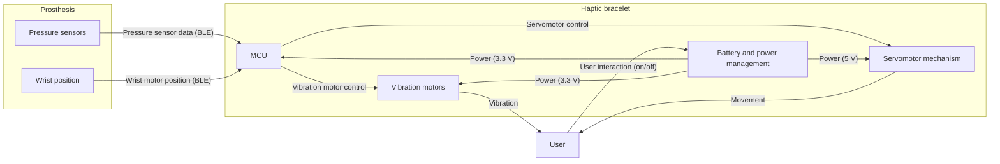

# Design Solution Definition: `Haptics`

> **Project:** `Haptics`
> **Document ID:** `DSD-01-Haptics`
> **Version:** `0.1.0` · **Status:** `Draft`
> **Project phase:** `Proof of concept`
> **Last modified:** `2026-10-17`
> **Repository path:** `Haptics-2026/SDR/DSD_Haptics-01.md`

HOW TO USE THIS TEMPLATE
- Replace every `<placeholder>`. Delete guidance comments before review.
- One DSD per subsystem or module
- The DSD must stand alone: a reviewer should be able to judge the design
  from this document, the linked requirements, and the linked evidence.
- Normative language: "shall" = requirement, "should" = recommendation,
  "may" = optional.

---

## Document control

### Roles and sign-off

| Role | Name | Affiliation / Handle | Date | Signature / Review link |
|---|---|---|---|---|
| Author(s) | Ana Benavente | Team Leader / anabenaventez-hub | | |
| Reviewer (technical) | | | | |
| Concurrence (SE Reviewer) | | | | |
| Concurrence (Quality management reviewer) | | | | |
| Approval (Project Manager) | | | | |

> Note : Link approval to any relevant PR (Pull Request)
> Affiliation/Handle : Role/ Username on Github

### Modification log

| Version | Date | Author(s) | Main changes | PR / Commit |
|---|---|---|---|---|
| 0.1.0 | 2026-10-17 | Ana Benavente | First version | |

---

## Table of contents

1. [Introduction](#1-introduction)
2. [Requirements and traceability](#2-requirements-and-traceability)
3. [Concept justification](#3-concept-justification)
4. [Traded-off concepts](#4-traded-off-concepts)
5. [Quality management and compliance](#5-quality-management-and-compliance) /!\ THIS SECTION IS NOT FINALISED /!\
6. [Licensing](#6-open-source-considerations) /!\ THIS SECTION IS NOT FINALISED /!\
7. [Open issues and future work](#7-open-issues-and-future-work)
8. [References](#8-references)
9. [Appendices](#9-appendices)

---

## 1. Introduction

### 1.1 Purpose and scope

<!-- Why does this document exist, at which review/milestone is it produced,
and what decision does it support? State what is IN and OUT of scope. 

DO NOT CHANGE ANYTHING IN THIS SECTION EXCEPT THE HIGHLIGHTED SECTIONS -->

This Design Solution Definition (DSD) is at a `Proof of concept` stage
validated on `<date>`. It justifies the concept selected for `Haptics`.

It covers:

- the problem the subsystem must solve
- the retained concept: architecture, components, and design choices
- the concepts that were considered and not retained
- risks, quality, and compliance implications.

**Out of scope:** `Not relevant.`

### 1.2 Responsibility and change authority

<!-- Who owns this document? Who may approve changes? How are changes
proposed (issue, RFC, pull request)? -->

- **Document owner:** `Ana Benavente / Haptics` <!-- Who is responsible to keep this document up to date ? --> 
- **Change authority:** `Team Leader / N-Pulse` <!-- What is the role/responsibility of the person -->

### 1.3 Abbreviated terms and definitions

| Term | Definition |
|---|---|
| `BLE` | `Bluetooth Low Energy` |
| `GND` | `Ground` |
| `LED` | `Light-Emitting Diode` |
| `MCU` | `Microcontroller Unit` |
| `NTC` | `Negative Temperature Coefficient` |
| `PCB` | `Printed Circuit Board` |
| `PWM` | `Pulse Width Modulation` |

## 2. Requirements and traceability

<!-- Do not duplicate the full requirements document. Link to it and list only
the requirements this design directly addresses. -->

| Requirement ID | Verification method | Status |
|---|---|---|
| HA-001  | D  | In-progress  |
| HA-002  | I  | In-progress |
| HA-003  | T  | To do  |
| HA-004  | D  | In-progress   |
| HA-005  | T  |  In-progress  |
| HA-006  | T  | In-progress |
| HA-007  | D  | In-progress   |
| HA-008  | T  | To-do  |
| HA-009  | I  | In-progress   |
| HA-010  | T  | In-progress   |
| HA-011  | T  | To do  |
| HA-012  | T | In-progress |
| HA-013  | T | In-progress |
| SYS-041  | D  | To do |
| SYS-040  | D  | To do  |
| SYS-039  | D  | To do  |
| SYS-034 | D  | In-progress  |
| SYS-035  |  M | To do  |
| SYS-031  | T  | To do  |
| SYS-029  | T  | In-progress  |
| SYS-030 | D |  In-progress |
| SYS-028  | T  | In-progress  |
| SYS-027  | T  | To do  |
| SYS-021  | D  | To do  |
| SYS-022 | I  | To do  |
| SYS-019  |  T | In-progress  |
| SYS-020  | T  | In-progress  |
| SYS-018  | T  | To do |
| SYS-016 | T  | To do  |
| SYS-011  | D  | In-progress  |
| SYS-010  | T  | To do  |
| SYS-017  | T  | To do  |
| SAF-005 | I  | In-progress  |
| SAF-008  | T  | In-progress  |
| SAF-009 | T  | To do  |

> **Verification methods:** (D)emonstration, (T)est, (M)easurement, (I)nspection, (A)nalysis
 

---

## 3. Concept justification

`<Explain HOW the design addresses the technical problem it's trying to solve. Every major element should trace back to a need or requirement>`

The following chapters and sub-chapters are an example. Tailor them to be the most relevant to your own system.

### 3.1 Solution overview

`The retained concept is a wearable bracelet that turns the contact pressure measured at the prosthesis finger tips into vibration on the user’s skin, addressing the problem of sensation feedback. Pressure readings are sent wirelessly to the bracelet, where an MCU converts them into vibration of different intensities, so the user can feel contact without looking at the hand. Additionally, the prosthesis’s wrist extension and flexion, given by the motor position, are also sent to the bracelet, which reproduces this movement with a servomotor. The architecture was selected to meet all the requirements while keeping power consumption low, the device compact, and operation safe, comfortable and reliable for the user.`

<!-- Mermaid renders natively on GitHub. Alternatively link an image from
`docs/figures/`. Include interfaces: data, mechanical, electrical,
biological/sample flow, and user interaction. -->

*Figure 3.1: High-level architecture of `Haptics`.*

### 3.2 Main design choices

<!-- One subsection per significant choice. Use this pattern:
Decision · Rationale · Requirements addressed · Consequences. -->

#### 3.2.1 `Battery and power system`

- **Decision:** `Power the bracelet using a 7.4 V 3400 mA 2S Li-Ion pack through an on/off switch with 2 buck converters (3.3 and 5 V) as well as temperature control via the thermistor.`
- **Rationale:** `Prioritize battery and user safety, as well as efficient buck conversion for stable rails and have enough headroom for the 5V rail, with a usage of minimum 4 hours.`
- **Requirements addressed:** `HA-001, HA-011, SYS-034, SYS-019, SYS-020, SYS-018, SYS-010, SAF-008.`
- **Consequences / limitations:** `Need of 2S protection board and charger, and visible warning of temperature as well as thermometer calibration.`

#### 3.2.2 `Wireless communication`

- **Decision:** `Use an ESP32-C3 Super Mini as the bracelet's MCU, receiving pressure and wrist-position data from the prosthesis via BLE.`
- **Rationale:** `BLE is built onto the chip and is low power, removing any wires between the prosthesis and bracelet, allowing the user to manipulate the bracelet separately.`
- **Requirements addressed:** `HA-009, SYS-029, SYS-016, SYS-017.`
- **Consequences / limitations:** `Latency and range depend on BLE.`

#### 3.2.3 `Pressure sensors and circuit`

- **Decision:** `Use 5 (one per fingertip) resistive force-sensing sensors (FSR 400) to transduce contact pressure into an analog signal, each read through a voltage divider with a fixed resistor (1 kΩ), chosen experimentally to maximize sensitivity over the force range expected at the prosthesis.`
- **Rationale:** `Thin, low-cost, responsive to light contact, and low-power.`
- **Requirements addressed:** `HA-004, HA-005, HA-006, HA-007, HA-008, HA-009, HA-010, SYS-028, SYS-021, SYS-011.`
- **Consequences / limitations:** `Need of calibration, has a non-linear response, and a sensitivity trade-off for certain force ranges.`

#### 3.2.4 `Vibration feedback`

- **Decision:** `Render the pressure measured at 3 of the prosthesis finger tips sensors as vibration on the skin, using 3 vibration motors with intensity increasing with pressure.`
- **Rationale:** `Direct way of reproducing sensation by stimulating tactile receptors intuitively and perceptively, using 3V vibration motors which are low-cost, low-power, and light. By only having 3 out of the 5 signals as outputs, the user gets enough pressure information without having to handle too much.`
- **Requirements addressed:** `HA-002, HA-003, HA-004, HA-005, HA-006, HA-007, HA-008, SYS-031, SYS-028, SYS-021, SYS-011.`
- **Consequences / limitations:** `Skin could adapt to continuous vibration, so sustained contact could become less noticeable over time, and intensity levels have a resolution trade-off, limited by latency.`

#### 3.2.5 `Servomotor feedback`

- **Decision:** `Render the prosthesis's wrist position (flexion/extension), given by the wrist motor position, as a movement of a servomotor mechanism on the bracelet.`
- **Rationale:** `Motion following the natural direction and position of the wrist intuitively.`
- **Requirements addressed:** `HA-002, HA-003, SYS-031.`
- **Consequences / limitations:** `Adds to power draw, size and mechanical & electrical complexity, must be comfortable and safe, and range must be matched to wrist movement, also limited by latency.`

#### 3.2.6 Operating modes

<!-- For instruments: operating modes. For protocols and pipelines: workflow
stages. Include entry and exit conditions and what is active in each. -->

| Mode / Stage | Purpose | Entry condition | Exit condition | Active components |
|---|---|---|---|---|
| Idle | Wait for the prosthesis to connect with minimal power use and no output to the user.|Power switch turned on and boot finished (after Calibration), or BLE link lost while no fault is present.  | BLE connection established with the prosthesis (goes to Nominal) or a fault is detected (goes to Safe / fault).| MCU with BLE advertising, power management (buck converters), BLE status LED. Vibration motors, servomotor and drivers are off.|
| Nominal operation |Convert incoming pressure and wrist position data into vibration and servomotor feedback. |BLE connected and valid data being received.|BLE link lost or no data (goes to Idle), fault detected (goes to Safe / fault), or power switch off. | MCU and BLE, vibration motors with their drivers (PWM), servomotor, battery and power rails, temperature monitoring (NTC). |
| Calibration | Move the servomotor to position 0 so it always starts from the same reference, matching the zero of the prosthesis’s wrist position.| Power switch turned on (runs automatically after boot), or re-homing requested by the user or over BLE.| Servomotor reaches position 0 (goes to Idle), or homing fails (goes to Safe / fault).|MCU, servomotor and its 5 V rail. Vibration motors off, BLE can start in parallel. |
| Safe / fault state | Protect the user and the hardware by stopping the outputs when battery's temperature rises or the switch is turned off.|Battery temperature above 40 °C or turned off manually. | Condition cleared (goes to Idle), or a latched fault requires the user to switch off and on. | MCU, temperature monitoring (NTC), over-temperature LED. Vibration motors and servomotor are disabled. BLE can stay on to report the fault.|

### 3.3 Functionally linked systems

#### 3.3.1 `Electronics circuits`

This section describes the electronic circuit design of the latest PCB iteration. The PCB integrates the power supply, microcontroller, motor drivers, temperature monitoring, and status LED interfaces into a single 2-layers board (36x45 mm).

###### 3.3.1.1 `Battery Connection and Temperature`

The battery interface provides the electrical connection between the battery and the PCB, enables manual system power control, and supports battery temperature monitoring to improve system safety.

<!--[Insert zoomed-in schematic of the battery interface and temperature monitoring circuit]-->

Figure XX illustrates the battery connector and temperature monitoring circuit.

The battery interface consists of a four-pin header connector, connected to the temperature monitoring circuit. The functions of the four connector pins are described below:
- **Pin 1 - Switch ground**: Connected to the external switch ([insert switch model]) and provides the ground connection required for its operation when the system is manually switched off.
- **Pin 2 – Battery supply (`BatOn`)**: Receives the battery supply voltage when the external switch is activated, enabling the system to be powered on and off manually by the user.
- **Pin 3 – Ground**: Connected to the battery ground, providing a common ground reference for the PCB and external components.
- **Pin 4 – Temperature sensing**: Connected to the battery's temperature-dependent resistive wire, whose resistance decreases as the battery temperature increases (NTC).

The temperature monitoring circuit uses a voltage divider to convert the temperature-dependent resistance into a voltage at the node labelled `Temp`. This voltage is read by the MCU, which uses it to determine whether the battery temperature has exceeded the defined safety threshold and whether the system should be switched off.

The 10 kΩ resistor `R4` is used as part of the voltage divider to establish the relationship between the temperature-dependent resistance and the voltage measured at the `Temp` node. Its selection is based on the nominal resistance range of the temperature-dependent resistive wire and the desired measurement sensitivity. 
(should i insert model and give more info about component?)

The 100 nF capacitor `C2` is connected to node `Temp` and is intended to filter voltage fluctuations and stabilize the temperature measurement. Its capacitance was selected based on standard heuristics, a 100nF is a baseline local bypass value because it adequately supplies high-frequency transient demands for standard gate speeds without excessive physical size. (should i insert model and give more info about component?)

The external switch (E-Switch, RA12131121) is a rocker switch, that was selected to provide ease of use for the usr, simplfied mechanical integration (snap-in mounting) with the CAD model of the bracelet and suitable current and voltage ratings for the external battery. 
(should i insert values? current rating of the switch: 16A and voltage rating: 125VAC (but we are using DC))

The `Temp` signal is connected to MCU pin `GPIO7`, which monitors the voltage and triggers a system shutdown when the defined temperature threshold is reached. The corresponding threshold is will be set experimentally to be associated with a battery temperature of 40°C (i think we said 40).

The manual power switch and temperature monitoring circuit therefore provide two complementary functions: user-controlled power management and temperature-based system protection.

##### 3.3.1.2 `Power Supply: 5 V and 3.3 V Rails`

The power supply consists of two DC–DC buck converters that convert the battery voltage into regulated 5 V and 3.3 V supply rails. The 5 V rail powers the servomotor, while the 3.3 V rail supplies the MCU and the three vibration motor drivers. Using two converters allows each part of the system to receive the voltage it requires.

<!--[Insert zoomed-in schematic of the 5 V and 3.3 V power supply circuits]-->

Figure XX illustrates the schematics of the two power supply circuits.

The 5 V rail is generated by the Texas Instruments TPS62153 integrated circuit (`IC5`), while the 3.3 V rail is generated by the TPS62142 (`IC4`). Both are buck converters, which reduce the battery voltage to a lower, regulated output voltage.
Each converter uses an inductor, input and output capacitors, a soft-start capacitor, and a resistor connected to the `PG` output. The inductors `L3` and `L2` (2.2 µH) are part of the switching circuits that transfer energy from the input to the output. The input capacitors `C12` and `C9` (10 µF) help stabilize the voltage supplied to the converters, while the output capacitors `C13` and `C10` (22 µF) smooth the output voltage and help handle sudden changes in load current.
The capacitors connected to the `SS/TR` pins control the soft-start behaviour of the converters. Soft-start allows the output voltage to rise gradually when the circuit is switched on, reducing the initial current demand. `C11` (620 pF) is used in the 5 V circuit, while `C8` (390 pF) is used in the 3.3 V circuit. Resistors `R6` and `R5` (100 kΩ) connect the PG pins to their respective output rails. These resistors act as pull-ups for the converters' power-good signals, which indicate whether the output voltage has reached an acceptable level.

The converter circuits and their external components were selected using Texas Instruments' WEBENCH® Power Designer, a tool for designing switching power supplies and selecting suitable components. The design was based on the required output voltages, the battery's input voltage range, and the expected load currents.

The PCB layout was designed with reference to the manufacturer's layout recommendations. The placement of components and routing of tracks are important in switching power supplies because they affect electrical noise, unwanted voltage variations, and power losses.

The input capacitors were placed close to the converter ICs to reduce the length of the paths carrying rapidly changing currents. The inductors were placed close to the switching nodes, and high-current tracks were kept short to reduce resistance and unwanted electrical effects. The output voltage-sensing connections were routed close to the output capacitors and away from the switching nodes to reduce interference with these sensitive signals. The analog ground (`AGND`), power ground (`PGND`), and exposed thermal pad were connected to the common ground according to the manufacturer's recommendations. The thermal pad also helps transfer heat from the IC to the PCB.
The battery connector was positioned near the power supply circuits.

Finally, the two converters share the battery input (`BatOn`) and a common ground reference, while providing separate regulated outputs for the system's components.

##### 3.3.1.3 `Microcontroller and Peripheral Interfaces`

The microcontroller used in the system is the ESP32-C3 SuperMini, which coordinates the operation of the servomotor and the three vibration motors based on pressure data received from the prosthesis main board. It communicates with the main board via BLE and generates PWM signals to control motor actuation. The microcontroller also controls two status LEDs, which indicate the temperature-monitoring and BLE communication status.

<!--[Insert zoomed-in schematic of the circuit]-->

The servomotor control signal is connected to `GPIO10`. The three vibration motor drivers are controlled through `GPIO0`, `GPIO1`, and `GPIO3`, respectively. PWM signals allow the motor actuation to be adjusted by varying the duty cycle. The vibration motors are connected through transistor-based driver circuits, as described in Section [3.3.1.4], since the microcontroller GPIOs cannot directly supply the current required by the motors.

The microcontroller also controls two status LEDs: the temperature-monitoring LED (`LEDTemp`) through `GPIO5` and the BLE status LED (`LEDBLE`) through `GPIO6` to  provide visual indications of the system's operating stat (see Section [3.3.2]).

Communication with the prosthesis main board is performed via BLE. The pressure data received wirelessly are processed by the firmware (see Section [3.3.2]), which determines the corresponding motor commands. These commands are then translated into PWM signals to control the servomotor and vibration motor drivers.

The ESP32-C3 is powered by the regulated 3.3 V rail and connected to the common ground. `GPIO8`, `GPIO9`, `GPIO20`, `GPIO4`, and `GPIO2` are left unconnected in the current design because they are not required for the implemented functionality [documentation said it was better not use them].

##### 3.3.1.4 `Transistor-Based Motor Drivers and Motor Connectors`  

The three vibration motors are controlled by three transistor-based driver circuits that allow the MCU to regulate motor activation without supplying the motor current directly through its GPIO pins. Each driver uses an N-channel MOSFET configured as a low-side switch, controlled by a PWM signal generated by the MCU.

<!--[Insert zoomed-in schematic of the circuit]-->

The switching component is the AO3400A MOSFET (`Q1`, `Q2`, `Q3`) from Alpha & Omega Semiconductor Inc. Its source is connected to ground, while its drain is connected to one terminal of the motors through the `M1out2`, `M2out2`, `M3out2` connections. The other motor terminals, `M1out1`, `M2out1`, `M3out1`, are connected to the regulated 3.3 V rail. When the MOSFET is switched on, current flows from the 3.3 V supply through the motor and the MOSFET to ground, activating the motor. When the MOSFET is switched off, the current path is interrupted and the motor is deactivated. By switching the MOSFET using a PWM signal, the MCU can adjust the motor's effective power by varying the duty cycle.

The MOSFET gates are controlled by the MCU signals `M1in`, `M2in`, `M3in` through the resistors `R8`, `R12`, `R10` (220 Ω), respectively. These series resistors limit the current flowing into the gates during switching. Resistors `R7`, `R10`, `R9` (10 kΩ) connect the gates to ground acting as pull-down resistances, keeping the MOSFET off when the control signal is low or not actively driven.

The AO3400A was selected as a compact N-channel MOSFET suitable for switching applications. Its low on-state resistance at gate-source voltages of 2.5 V and 4.5 V supports operation with the ESP32-C3's 3.3 V control signals. The final selection also accounts for the vibration motor's operating and startup currents [check].

Two additional components are connected in parallel with the motors. Capacitors `C3`, `C5`, `C4` (100 nF) help suppress high-frequency electrical noise generated by the motor. Schottky diodes `D5`, `D6`, `D4` provide a path for the inductive current when the MOSFET switches off, helping limit voltage spikes that could otherwise damage the switching transistor. The diode is connected across the motor terminals, with its polarity arranged to remain reverse-biased during normal motor operation.

The motors are connected to the driver through the `M_out1` and `M_out2` terminals. The same driver topology is replicated for the three vibration motors, with each MOSFET controlled independently by its corresponding microcontroller GPIO. This allows the firmware to activate and regulate each motor separately.

##### 3.3.1.5 `Status LED Interface`  

<!--[Insert zoomed-in schematic of the circuit]-->

Describe the status LED interface and its role in providing visual feedback on the system state. Explain the function of the associated components, including any current-limiting resistors, and justify their selection based on the LED specifications and required operating current.

#### 3.3.2 `Firmware`
add code diagram, why we are using thresholds, bluetooth receiving, explain code generally.

#### 3.3.3 `Mechanics`
add CAD designs, explain modular system, where cables would go, how the battery/board are going to be placed.

### 3.4 Performance budgets and design margins

[Mass/Power/Compute/Delay budgets](https://docs.google.com/spreadsheets/d/1crh8A0cA0GD1TBoOaqpi6O97k_zhQEbA1Yp0f57wpJg/edit?usp=sharing) 

---

## 4. Traded-off concepts

<!-- Show your work. This section protects the project from re-litigating
decisions and records why alternatives were rejected. -->

`<This is the most important part of this document. Please fill it in with great attention. >`

`<The goal of this section is to go over every other solution you found relevant but that you chose not to pursue.>`

### 4.1 Trade-off method

The trade-off method used was based on the following criteria : 
- `<criteria nmbr 1>`
- `<criteria nmbr 2>`
- ...

`<Describe criteria, weights, and scoring scale. This is a standardized way to explicit your priorities in the design.>`

 The table given below is an example. Adapt it with the above mentionned criterias

`<example for an ADC chip for a proof of concept board>`

| Criterion | Weight (1 - 5) | Rationale for weight |
|---|---|---|
| Meets performance requirements | 5 | This ADC was chosen to be part of a first proof of concept. As such, performance is the priority. |
| Safety and biosafety | 3 | ADC is not in direct contact with the patient. While a medical approved chip is favourable, it is not mandatory |
| Cost | 3 | This is a proof of concept. The ADC is ordered in small batch and as such prices are higher. Additionally, budget is a constraint for this board  |
| Reproducibility and accessibility | 4 | Proof of concept. By definition needs to work reliabily and predictably |
| Supply chain robustness  | 2 | This ADC has high performance requirements that cannot be fulfilled with common chips. |
| Maintainability and community support | 1 | This is not expected to be replaced, changed or maintained. |

Score scale : 
> [1] : Does not meet any requirements
> [2] : Meets some requirements 
> [3] : Meets all minimum requirements 'Shall' requirements
> [4] : Meets all minimum requirements and 'should'
> [5] : Meets all requirements, 'Shall, should & may'

### 4.2 Traded-off design choices

#### 4.2.1 `<Alternative design choice A>`

- **Description:**
- **Pros**:
- **Cons**:

#### 4.2.2 `<Alternative design choice A>` score

 

| Criterion | Weight (1-5) | score (1-5) |
|---|---|---|
| Meets performance requirements | 5 | 3 |
| Safety and biosafety | 3 | 5 |
| Cost | 3 | 1 |
| Reproducibility and accessibility | 4 | 4 |
| Supply chain robustness* | 2 | 2 |
| Maintainability and community support | 1 | 1 |
| ---|---|---|
|Total Score| 54 | max score : 90 | 

#### 4.2 `<Retained design choice>` score

- **Pros**:
- **Cons**:

| Criterion | Weight (1-5) | score (1-5) |
|---|---|---|
| Meets performance requirements | 5 | 4 |
| Safety and biosafety | 3 | 3 |
| Cost | 3 | 3 |
| Reproducibility and accessibility | 4 | 4 |
| Supply chain robustness* | 2 | 3 |
| Maintainability and community support | 1 | 2 |
| ---|---|---|
|Total Score| 62 | max score : 90 | 

### 4.3 Trade-off summary

| Option | Score | Retained | Key reason |
|---|---|---|---|
| Retained concept | 62 | Yes | Better performance, lower price |
| Alternative A | 54 | No | Too expensive, lower performance|

## 5. Quality management and compliance

**WORK IN PROGRESS**
<!--
<!-- Adapt to your regulatory context. If the project is RUO-only, say so and
explain which parts apply by choice (good practice) versus by obligation. 

### 5.1 Regulatory classification and pathway

| Item | Statement |
|---|---|
| Intended use classification | `<RUO / IVD / medical device / bioprocess / environmental / other>` |
| Target jurisdictions | `<EU / US / CH / UK / other>` |
| Applicable regulation | `<e.g. EU IVDR 2017/746, EU MDR 2017/745, FDA 21 CFR 820 (QMSR), 21 CFR Part 11>` |
| Device / product class | `<class and rationale>` |
| Regulatory strategy | `<summary, notified body / agency contact status>` |

### 5.2 Quality management system

- **QMS framework:** `<ISO 13485 / ISO 9001 / GLP / GMP / GCP / lightweight in-house QMS>`
- **QMS scope and document hierarchy:** `<link>`
- **Design controls followed:** `<design inputs → outputs → review → verification → validation → transfer → changes>`
- **This document's place in the design history file (DHF):** `<link>`

### 5.3 Applicable standards and guidelines

| Standard / Guideline | Title | Applicability | Compliance status |
|---|---|---|---|
| ISO 13485 | Medical devices: Quality management systems | | Planned / Partial / Compliant / N/A |
| ISO 14971 | Application of risk management to medical devices | | |
| IEC 62304 | Medical device software life cycle | | |
| IEC 61010-1 | Safety of electrical equipment for measurement, control, laboratory use | | |
| IEC 62366-1 | Usability engineering | | |
| ISO 20387 | Biobanking: general requirements | | |
| `<other>` | | | |

### 5.4 Ethics, access, and biosecurity compliance

| Topic | Applicability | Status / reference |
|---|---|---|
| Ethics committee / IRB approval | | |
| Informed consent | | |
| Nagoya Protocol / access and benefit sharing | | |
| Biosafety committee approval | | |
| Import / export / dual-use controls | | |
| Animal research regulations | | |

-->

## 6. Licensing

**WORK IN PROGRESS**

<!--
| Topic | Decision |
|---|---|
| Hardware license | `<CERN-OHL-S / CERN-OHL-W / TAPR / other>` |
| Software license | `<Apache-2.0 / GPL-3.0 / MIT / other>` |
| Documentation and data license | `<CC-BY-4.0 / CC0 / other>` |
| Open Source Hardware certification | `<OSHWA status>` |
| Licence compatibility of all dependencies | `<checked on YYYY-MM-DD, link to SBOM>` |
| Patents / IP / prior art | `<statement, defensive publication?>` |
| Contribution and governance model | `<link to CONTRIBUTING.md / GOVERNANCE.md>` |
| Liability and warranty disclaimer | `<statement, especially for any clinical use>` |
| Sourcing for builders | `<BOM with alternates, availability of parts worldwide>` |
| Quality of community-contributed changes | `<review gates, required tests, who can merge>` |

-->

## 7. Open issues and future work

| ID | Issue / TBD / TBC | Owner | Due | Impact if unresolved |
|---|---|---|---|---|
| OI-01 | | | | |

---

## 8. References

1. `<Applicable documents (binding): requirements spec, standards, regulations>`
2. `<Reference documents (informative): papers, datasheets, prior DSDs>`

---

## 9. Appendices

### Appendix A: Bill of materials

`<link to BOM file>`

<!-- FILL With relevant items>
