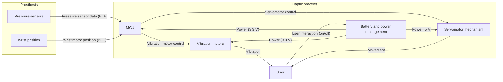
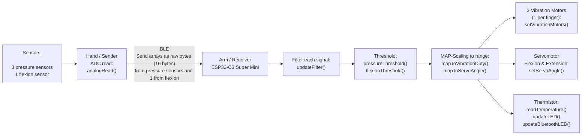

# Design Solution Definition: `Haptics`

> **Project:** `Haptics`
> **Document ID:** `DSD-01-Haptics`
> **Version:** `0.1.0` · **Status:** `Draft`
> **Project phase:** `Proof of concept`
> **Last modified:** `2026-10-17`
> **Repository path:** `Haptics-2026/SDR/DSD_Haptics-01.md`

HOW TO USE THIS TEMPLATE
- Replace every `<placeholder>`. Delete guidance comments before review.
- One DSD per subsystem or module
- The DSD must stand alone: a reviewer should be able to judge the design
  from this document, the linked requirements, and the linked evidence.
- Normative language: "shall" = requirement, "should" = recommendation,
  "may" = optional.

---

## Document control

### Roles and sign-off

| Role | Name | Affiliation / Handle | Date | Signature / Review link |
|---|---|---|---|---|
| Author(s) | Ana Benavente | Team Leader / anabenaventez-hub | | |
| Reviewer (technical) | | | | |
| Concurrence (SE Reviewer) | | | | |
| Concurrence (Quality management reviewer) | | | | |
| Approval (Project Manager) | | | | |

> Note : Link approval to any relevant PR (Pull Request)
> Affiliation/Handle : Role/ Username on Github

### Modification log

| Version | Date | Author(s) | Main changes | PR / Commit |
|---|---|---|---|---|
| 0.1.0 | 2026-10-17 | Ana Benavente | First version | |

---

## Table of contents

1. [Introduction](#1-introduction)
2. [Requirements and traceability](#2-requirements-and-traceability)
3. [Concept justification](#3-concept-justification)
4. [Traded-off concepts](#4-traded-off-concepts)
5. [Quality management and compliance](#5-quality-management-and-compliance) /!\ THIS SECTION IS NOT FINALISED /!\
6. [Licensing](#6-open-source-considerations) /!\ THIS SECTION IS NOT FINALISED /!\
7. [Open issues and future work](#7-open-issues-and-future-work)
8. [References](#8-references)
9. [Appendices](#9-appendices)

---

## 1. Introduction

### 1.1 Purpose and scope

<!-- Why does this document exist, at which review/milestone is it produced,
and what decision does it support? State what is IN and OUT of scope. 

DO NOT CHANGE ANYTHING IN THIS SECTION EXCEPT THE HIGHLIGHTED SECTIONS -->

This Design Solution Definition (DSD) is at a `Proof of concept` stage
validated on `<date>`. It justifies the concept selected for `Haptics`.

It covers:

- the problem the subsystem must solve
- the retained concept: architecture, components, and design choices
- the concepts that were considered and not retained
- risks, quality, and compliance implications.

**Out of scope:** `Not relevant.`

### 1.2 Responsibility and change authority

<!-- Who owns this document? Who may approve changes? How are changes
proposed (issue, RFC, pull request)? -->

- **Document owner:** `Ana Benavente / Haptics` <!-- Who is responsible to keep this document up to date ? --> 
- **Change authority:** `Team Leader / N-Pulse` <!-- What is the role/responsibility of the person -->

### 1.3 Abbreviated terms and definitions

| Term | Definition |
|---|---|
| `BLE` | `Bluetooth Low Energy` |
| `GND` | `Ground` |
| `LED` | `Light-Emitting Diode` |
| `MCU` | `Microcontroller Unit` |
| `NTC` | `Negative Temperature Coefficient` |
| `PCB` | `Printed Circuit Board` |
| `PWM` | `Pulse Width Modulation` |

## 2. Requirements and traceability

<!-- Do not duplicate the full requirements document. Link to it and list only
the requirements this design directly addresses. -->

| Requirement ID | Verification method | Status |
|---|---|---|
| HA-001  | D  | In-progress  |
| HA-002  | I  | In-progress |
| HA-003  | T  | To do  |
| HA-004  | D  | In-progress   |
| HA-005  | T  |  In-progress  |
| HA-006  | T  | In-progress |
| HA-007  | D  | In-progress   |
| HA-008  | T  | To-do  |
| HA-009  | I  | In-progress   |
| HA-010  | T  | In-progress   |
| HA-011  | T  | To do  |
| HA-012  | T | In-progress |
| HA-013  | T | In-progress |
| SYS-041  | D  | To do |
| SYS-040  | D  | To do  |
| SYS-039  | D  | To do  |
| SYS-034 | D  | In-progress  |
| SYS-035  |  M | To do  |
| SYS-031  | T  | To do  |
| SYS-029  | T  | In-progress  |
| SYS-030 | D |  In-progress |
| SYS-028  | T  | In-progress  |
| SYS-027  | T  | To do  |
| SYS-021  | D  | To do  |
| SYS-022 | I  | To do  |
| SYS-019  |  T | In-progress  |
| SYS-020  | T  | In-progress  |
| SYS-018  | T  | To do |
| SYS-016 | T  | To do  |
| SYS-011  | D  | In-progress  |
| SYS-010  | T  | To do  |
| SYS-017  | T  | To do  |
| SAF-005 | I  | In-progress  |
| SAF-008  | T  | In-progress  |
| SAF-009 | T  | To do  |

> **Verification methods:** (D)emonstration, (T)est, (M)easurement, (I)nspection, (A)nalysis
 

---

## 3. Concept justification

`<Explain HOW the design addresses the technical problem it's trying to solve. Every major element should trace back to a need or requirement>`

The following chapters and sub-chapters are an example. Tailor them to be the most relevant to your own system.

### 3.1 Solution overview

`The retained concept is a wearable bracelet that turns the contact pressure measured at the prosthesis into vibration on the user’s skin, addressing the problem of sensation feedback. Pressure readings are sent wirelessly to the bracelet, where an MCU converts them into vibration of different intensities, so the user can feel contact without looking at the hand. Additionally, the prosthesis’s wrist extension and flexion, given by the motor position, are also sent to the bracelet, which reproduces this movement with a servomotor. The architecture was selected to meet all the requirements while keeping power consumption low, the device compact, and operation safe, comfortable and reliable for the user.`

<!-- Mermaid renders natively on GitHub. Alternatively link an image from
`docs/figures/`. Include interfaces: data, mechanical, electrical,
biological/sample flow, and user interaction. -->

*Figure 3.1: High-level architecture of `Haptics`.*

### 3.2 Main design choices

<!-- One subsection per significant choice. Use this pattern:
Decision · Rationale · Requirements addressed · Consequences. -->

#### 3.2.1 `Battery and power system`

- **Decision:** `Power the bracelet using a 7.4 V 3400 mAh 2S Li-ion pack through an on/off switch with 2 buck converters (3.3 and 5 V) as well as temperature control via the thermistor.`
- **Rationale:** `Prioritize battery and user safety, as well as efficient buck conversion for stable rails and have enough headroom for the 5V rail, with a usage of minimum 4 hours.`
- **Requirements addressed:** `HA-001, HA-011, SYS-034, SYS-019, SYS-020, SYS-018, SYS-010, SAF-008.`
- **Consequences / limitations:** `Need of 2S protection board and charger, and visible warning of temperature as well as thermometer calibration.`

#### 3.2.2 `Wireless communication`

- **Decision:** `Use an ESP32-C3 Super Mini as the bracelet's MCU, receiving pressure and wrist-position data from the prosthesis via BLE.`
- **Rationale:** `BLE is built onto the chip and is low power, removing any wires between the prosthesis and bracelet, allowing the user to manipulate the bracelet separately.`
- **Requirements addressed:** `HA-009, SYS-029, SYS-016, SYS-017.`
- **Consequences / limitations:** `Latency and range depend on BLE.`

#### 3.2.3 `Pressure sensors and circuit`

- **Decision:** `Use 5 (one per fingertip) resistive force-sensing sensors (FSR 400) to transduce contact pressure into an analog signal, each read through a voltage divider with a fixed resistor (1 kΩ), chosen experimentally to maximize sensitivity over the force range expected at the prosthesis.`
- **Rationale:** `Thin, low-cost, responsive to light contact, and low-power.`
- **Requirements addressed:** `HA-004, HA-005, HA-006, HA-007, HA-008, HA-009, HA-010, SYS-028, SYS-021, SYS-011.`
- **Consequences / limitations:** `Need of calibration, has a non-linear response, and a sensitivity trade-off for ranges.`

#### 3.2.4 `Vibration feedback`

- **Decision:** `Render the pressure measured at the prosthesis as vibration on the skin in 3 of the sensors, into 3 vibration motors with the intensity increasing with the pressure.`
- **Rationale:** `Direct way of reproducing sensation by stimulating tactile receptors intuitively and perceptively, using 3V vibration motors which are low-cost, low-power, and light. By only having 3 out of the 5 signals as outputs, the user gets enough information of the pressure without handling too much information.`
- **Requirements addressed:** `HA-002, HA-003, HA-004, HA-005, HA-006, HA-007, HA-008, SYS-031, SYS-028, SYS-021, SYS-011.`
- **Consequences / limitations:** `Skin could adapt to continuous vibration, so sustained contact could become less noticeable over time, and intensity levels have a resolution trade-off, limited by latency.`

#### 3.2.5 `Servomotor feedback`

- **Decision:** `Render the prosthesis's wrist position (flexion/extension), given by the wrist motor position, as a movement of a servomotor mechanism on the bracelet.`
- **Rationale:** `Motion following the natural direction and position of the wrist intuitively.`
- **Requirements addressed:** `HA-002, HA-003, SYS-031.`
- **Consequences / limitations:** `Adds to power draw, size and mechanical & electrical complexity, must be comfortable and safe, and range must be matched to wrist movement also limited by latency.`

#### 3.2.6 Operating modes

<!-- For instruments: operating modes. For protocols and pipelines: workflow
stages. Include entry and exit conditions and what is active in each. -->

| Mode / Stage | Purpose | Entry condition | Exit condition | Active components |
|---|---|---|---|---|
| Idle | Wait for the prosthesis to connect with minimal power use and no output to the user.|Power switch turned on and boot finished, or BLE link lost while no fault is present.  | BLE connection established with the prosthesis (goes to Nominal) or a fault is detected (goes to Safe / fault).| MCU with BLE advertising, power management (buck converters), BLE status LED. Vibration motors, servomotor and drivers are off.|
| Nominal operation |Convert incoming pressure and wrist position data into vibration and servomotor feedback. |BLE connected and valid data being received.|BLE link lost or no data (goes to Idle), fault detected (goes to Safe / fault), or power switch off. | MCU and BLE, vibration motors with their drivers (PWM), servomotor, battery and power rails, NTC temperature monitoring. |
| Calibration | Move the servomotor to position 0 so it always starts from the same reference, matching the zero of the prosthesis’s wrist position.| Power switch turned on (runs automatically after boot), or re-homing requested by the user or over BLE.| Servomotor reaches position 0 (goes to Idle), or homing fails (goes to Safe / fault).|MCU, servomotor and its 5 V rail. Vibration motors off, BLE can start in parallel. |
| Safe / fault state | Protect the user and the hardware by stopping the outputs when battery's temperature rises or the switch is turned off.|Battery temperature above 40 °C or turned off manually. | Condition cleared (goes to Idle), or a latched fault requires the user to switch off and on. | MCU, temperature monitoring (NTC), over-temperature LED. Vibration motors and servomotor are disabled. BLE can stay on to report the fault.|

### 3.3 Functionally linked systems

#### 3.3.1 `Electronics circuits`
add schematics, pcb boards, how we designed the power regulators, why we chose those components.

#### 3.3.2 `Firmware`
##### System Flowchart

##### General code architecture
The firmware is split into two independent Arduino sketches, one running on each board, with each sketch itself broken into multiple tabs.

On the hand side, the sender sketch (BLE_sender.ino) runs a loop that, every cycle, reads the three sensors (pressure sensors) through analogRead(). These three values are packed into a small array and are then converted into bytes (16 bytes). The array is sent out over Bluetooth Low Energy in pack every 5-10 ms (TBD).

On the arm side, the receiver sketch (BLE_receiver.ino) acts as the BLE client: it connects to the sender, awaits for incoming data, and unpacks it back into values. Each value is applied updateFilter() to smooth out raw readings. Then each filtered value passes through pressureThreshold() or flexionThreshold() to clamp it into a known, safe range. Each pressure value is sent to its corresponding vibration motor, and the flexion value is converted into an angle for the servomotor, using the mapping functions in (mapping.ino). Separately from this Bluetooth data flow, the receiver also reads a thermistor connected directly to the board, calculates the actual temperature, and lights an LED if that temperature crosses an established safety threshold. Another LED lights up when the receiver and the sender are connected via BLE and turns off when the two boards lose their link. 

##### Thresholding and Amplitude Mapping

The filtered ADC readings are processed using thresholds to improve signal stability, ensure safe operating limits, and make changes in sensation more perceptible. First, a noise-floor threshold suppresses small fluctuations caused by electrical noise in the resistive pressure sensors. Readings below this threshold are set to zero, preventing unintended or “phantom” vibrations when no meaningful pressure is applied. The signals are then clamped to predefined minimum and maximum values to prevent out-of-range measurements from producing invalid motor or servo commands.

Next, the valid pressure readings are divided into multiple threshold intervals. Each interval corresponds to a different vibration amplitude, allowing the haptic feedback to produce distinct intensity levels rather than small, potentially imperceptible changes in motor output. 

Finally, the resulting values are mapped to the permitted output range of the vibration motors and servomotor mechanism. For vibration motors, the mapped value controls the PWM duty cycle, while for the servomotor, it determines the target angle within its allowed operating range. This approach improves signal robustness, output safety, and the perceptibility of changes in haptic feedback.

##### BLE Communication

The two boards communicate using a client–server BLE architecture. The hand-side board, currently tested on an ESP32-S3, acts as the server by creating a BLE service and characteristic and advertising its availability, while the arm-side ESP32-C3 acts as the client and actively connects to the server using its known address. Approximately every 10 milliseconds, the client reads the characteristic to retrieve the latest sensor data. The communication uses raw bytes rather than explicitly typed values: the sender converts an array of three integers into a byte sequence using a pointer cast (`(uint8_t*)packet`), and the receiver uses `memcpy()` to reconstruct the original four integers. Before processing the received data, the client verifies that the payload length matches the expected size (`value.length() == sizeof(int) * 4`), preventing malformed or incomplete packets from being interpreted as valid sensor readings.

#### 3.3.3 `Mechanics`
General structure of the bracelet : 
The bracelet consists of three parts: the component for finger-pressure feedback, the component for wrist-flexion feedback, and the battery/circuit board section. Finally these parts are all connected by a Velcro strip to fit the arm. 

##### The pressure feedback : 
Structure : 
The pressure feedback component consists of three identical modules for providing feedback to the thumb, index finger, and middle finger. Each of these modules measures 32 mm in height, 26 mm in width, and 5 mm in thickness, and consists of three parts:
* The main body : It includes a hole on each side for the straps to pass through and has a cavity in the center to house the vibrator.
* The vibrator : It goes in the cavity in the main body of the module.
* The cap : It enclose the vibrator within the module and allows the cables to pass through via a small hole on the back.
[Pressure feedback assembly](https://drive.google.com/file/d/1q7tmiTraR-jlEE6LJhXr1u1NyFAoutsr/view?usp=drive_link)
[Pressure feedback CADs](https://drive.google.com/drive/folders/1Q9jedtYQnt1176AdBbXqwLDbgV0Av4K-?usp=drive_link)

##### The flexion feedback : 
Structure :
The flexion feedback module is 60mm high, 60mm wide and 21mm thick and consists of five parts :
* The main body : It includes a hole on each side for the straps to pass through, has un hole for the rail and a place for the servo.
* The rail : It consists of two parts: the top, which features teeth, and the bottom, which has a 5mm bump. These two parts are held together by two guides on the top piece and a pin at each end of the rail.
* The servo : It goes in the place in the main body of the module and is coonected to the gear.
* The gear : It forms the connection between the servo and the rail.
* The cap : It enclose the servo and allows the cables to pass through via a small hole on the side.
[Flexion feedback assembly](https://drive.google.com/file/d/1da2Mox3atejDgfT-ykYJN5pDtji0LcrP/view?usp=drive_link)
[Flexion feedback Cads](https://drive.google.com/drive/folders/18fYBH1grhHKaJqEiLSD7rRKpASQkbYJC?usp=drive_link)

How it works :
When the servo activates, it drives the gear, which in turn moves the rail in a linear motion that the user can feel due to the bump.

##### The battery/board pack : (It will need to be adjusted once we have received the battery and the board)
Structure :
The battery/board module measures 77.7 mm in height, 59 mm in width, and 36 mm in thickness, and consists of six components that fit into one another and are secured by pins:
* The main body : It includes a hole on each side for the straps to pass through and a place to put the first stage and the battery.
* The first stage : It is the main part that hold the battery. It is separate from the main body because printing both together would be too complicated due to floating regions.
* The battery : She's in the first stage and is held in place by the second stage.
* The second stage : It the part that holds the board and closes the battery section. It is separated from the main body for the same reasons as in the first stage.
* The board : She's in the second stage and is screwed to it.
* The cap : It encloses the board and features 2 holes for passing through two LEDs.
[Battery/board assembly](https://drive.google.com/file/d/13KTVKjT1o8PBZH2u7Te5b1pqeQ4y3S1g/view?usp=drive_link)
[Battery/board CADs](https://drive.google.com/drive/folders/1uHSiRIowJNreikrxuMxqF4VdFK1-pneW?usp=drive_link)

### 3.4 Performance budgets and design margins

[Mass/Power/Compute/Delay budgets](https://docs.google.com/spreadsheets/d/1crh8A0cA0GD1TBoOaqpi6O97k_zhQEbA1Yp0f57wpJg/edit?usp=sharing) 

---

## 4. Traded-off concepts

<!-- Show your work. This section protects the project from re-litigating
decisions and records why alternatives were rejected. -->

`<This is the most important part of this document. Please fill it in with great attention. >`

`<The goal of this section is to go over every other solution you found relevant but that you chose not to pursue.>`

### 4.1 Battery selection

The trade-off method used was based on the following criteria : 
- `Patient safety`
- `Battery capacity/performance`
- `Size`
- `Cost`

| Criterion | Weight (1 - 5) | Rationale for weight |
|---|---|---|
| Patient safety | 5 | Patient safety is the highest priority, as accidental drops or mechanical impacts could damage the battery, potentially causing an internal short circuit, thermal runaway, fire, or explosion, and consequently injuring the patient. The battery should therefore have a robust protective casing and appropriate protection against physical damage, overcharging, over-discharging, and short circuits. An NTC thermistor should monitor battery temperature to enable protective measures if unsafe temperatures are detected. |
| Battery capacity/performance | 5 | The battery shall meet the system's power requirements, provide a 7.4 V output, and have a minimum capacity of 3000 mAh to ensure sufficient operating time (4 hours). |
| Size | 4 | The battery should be compact and lightweight enough to integrate into the wearable system without significantly compromising user comfort, mobility, or ergonomics. |
| Cost | 3 | The battery should fit within the project's budget. Since components are purchased in small quantities, unit prices may be higher than those available through bulk purchasing. |

Score scale : 
> [1] : Does not meet any requirements
> [2] : Meets some requirements 
> [3] : Meets all minimum requirements 'Shall' requirements
> [4] : Meets all minimum requirements and 'should'
> [5] : Meets all requirements, 'Shall, should & may'

### 4.2 Traded-off design choices

#### 4.2.1 `Li-Po battery`

- **Description**: A lithium-polymer (Li-Po) rechargeable battery is considered as a compact power source for the wearable haptic system. The selected battery must provide a nominal voltage compatible with the power-management circuitry, a capacity of at least 3000 mAh, and sufficient energy to support approximately four hours of operation.
- **Pros**:
  * High energy density, allowing a compact and lightweight design.
  * Flexible form factors that can facilitate integration into a wearable device.
  * High discharge capability, depending on the selected battery specification.
  * Potential for improved user comfort due to reduced weight and compact dimensions.
- **Cons**:
  * Vulnerable to physical damage, punctures, and deformation, which may cause internal short circuits or thermal runaway.
  * Requires suitable charging, over-discharge, overcurrent, and temperature protection.
  * A protective enclosure is necessary to reduce the risk of damage from accidental drops and mechanical impacts.
  * The final cost depends on the required capacity, discharge rating, protection circuitry, and order quantity.
  
#### 4.2.2 `Li-Po battery` score

| Criterion | Weight (1-5) | score (1-5) |
|---|---|---|
| Patient safety | 5 | 2 |
| Battery capacity/performance | 5 | 5 |
| Size | 4 | 5 |
| Cost | 3 | 4 |
| ---|---|---|
|Total Score| 67 | max score : 85 | 

#### 4.2 `2S1P 7.4V battery pack NCR18650B li-ion 3400mAh>` score

- **Description**: This alternative consists of two lithium-ion 18650 cells connected in series (2S1P), providing a nominal pack voltage of approximately 7.2–7.4 V and a capacity of 3400 mAh. The pack is intended to supply the wearable system for approximately four hours, subject to actual power consumption and conversion losses. A suitable battery-management system (BMS), protective enclosure, and compatible charging circuit are required.
- **Pros**:
  * Capacity of 3400 mAh, exceeding the minimum requirement of 3000 mAh.
  * Nominal voltage compatible with a system designed for a 2-cell lithium-ion pack, subject to voltage regulation.
  * Standard cylindrical cells can be integrated into a rigid protective enclosure.
  * Potentially good availability and cost-effectiveness, depending on the supplier and pack configuration.
- **Cons**:
  * Larger and potentially heavier than a comparable Li-Po battery, which may reduce wearable comfort.
  * Requires a suitable 2S BMS, cell balancing, and a charger compatible with the pack's full-charge voltage.
  * The enclosure must protect the cells from impacts, crushing, and other mechanical damage
  * The additional weight and volume may constrain the mechanical design and placement of the battery.

| Criterion | Weight (1-5) | score (1-5) |
|---|---|---|
| Patient safety | 5 | 5 |
| Battery capacity/performance | 5 | 5 |
| Size | 4 | 3 |
| Cost | 3 | 4 |
| ---|---|---|
|Total Score| 74 | max score : 85 | 

### 4.3 Trade-off summary

| Option | Score | Retained | Key reason |
|---|---|---|---|
| Li-Po Battery | 67 | No | Compact and lightweight, but impact protection and safety requirements need further verification. |
| 2S1P 7.4V battery pack NCR18650B li-ion 3400mAh | 74 | Yes | Higher total weighted score, sufficient nominal capacity, and an assumed acceptable cost, despite the larger size.|

## 5. Quality management and compliance

**WORK IN PROGRESS**
<!--
<!-- Adapt to your regulatory context. If the project is RUO-only, say so and
explain which parts apply by choice (good practice) versus by obligation. 

### 5.1 Regulatory classification and pathway

| Item | Statement |
|---|---|
| Intended use classification | `<RUO / IVD / medical device / bioprocess / environmental / other>` |
| Target jurisdictions | `<EU / US / CH / UK / other>` |
| Applicable regulation | `<e.g. EU IVDR 2017/746, EU MDR 2017/745, FDA 21 CFR 820 (QMSR), 21 CFR Part 11>` |
| Device / product class | `<class and rationale>` |
| Regulatory strategy | `<summary, notified body / agency contact status>` |

### 5.2 Quality management system

- **QMS framework:** `<ISO 13485 / ISO 9001 / GLP / GMP / GCP / lightweight in-house QMS>`
- **QMS scope and document hierarchy:** `<link>`
- **Design controls followed:** `<design inputs → outputs → review → verification → validation → transfer → changes>`
- **This document's place in the design history file (DHF):** `<link>`

### 5.3 Applicable standards and guidelines

| Standard / Guideline | Title | Applicability | Compliance status |
|---|---|---|---|
| ISO 13485 | Medical devices: Quality management systems | | Planned / Partial / Compliant / N/A |
| ISO 14971 | Application of risk management to medical devices | | |
| IEC 62304 | Medical device software life cycle | | |
| IEC 61010-1 | Safety of electrical equipment for measurement, control, laboratory use | | |
| IEC 62366-1 | Usability engineering | | |
| ISO 20387 | Biobanking: general requirements | | |
| `<other>` | | | |

### 5.4 Ethics, access, and biosecurity compliance

| Topic | Applicability | Status / reference |
|---|---|---|
| Ethics committee / IRB approval | | |
| Informed consent | | |
| Nagoya Protocol / access and benefit sharing | | |
| Biosafety committee approval | | |
| Import / export / dual-use controls | | |
| Animal research regulations | | |

-->

## 6. Licensing

**WORK IN PROGRESS**

<!--
| Topic | Decision |
|---|---|
| Hardware license | `<CERN-OHL-S / CERN-OHL-W / TAPR / other>` |
| Software license | `<Apache-2.0 / GPL-3.0 / MIT / other>` |
| Documentation and data license | `<CC-BY-4.0 / CC0 / other>` |
| Open Source Hardware certification | `<OSHWA status>` |
| Licence compatibility of all dependencies | `<checked on YYYY-MM-DD, link to SBOM>` |
| Patents / IP / prior art | `<statement, defensive publication?>` |
| Contribution and governance model | `<link to CONTRIBUTING.md / GOVERNANCE.md>` |
| Liability and warranty disclaimer | `<statement, especially for any clinical use>` |
| Sourcing for builders | `<BOM with alternates, availability of parts worldwide>` |
| Quality of community-contributed changes | `<review gates, required tests, who can merge>` |

-->

## 7. Open issues and future work

| ID | Issue / TBD / TBC | Owner | Due | Impact if unresolved |
|---|---|---|---|---|
| OI-01 | | | | |

---

## 8. References

1. `<Applicable documents (binding): requirements spec, standards, regulations>`
2. `<Reference documents (informative): papers, datasheets, prior DSDs>`

---

## 9. Appendices

### Appendix A: Bill of materials

`<link to BOM file>`

<!-- FILL With relevant items>
